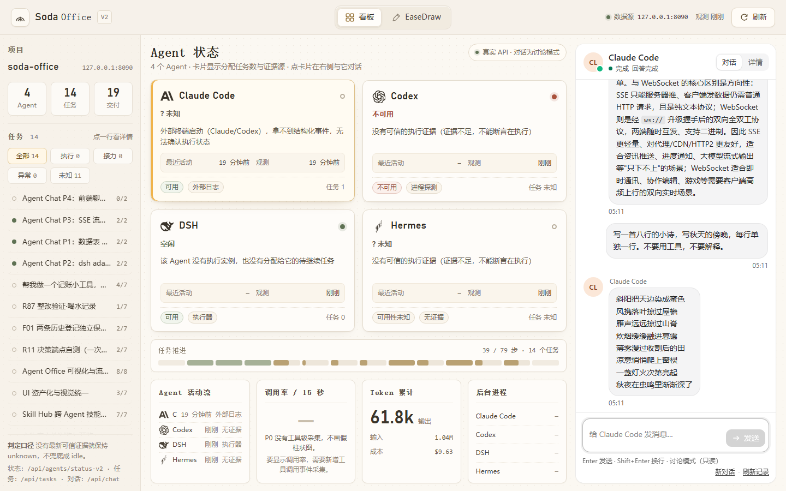
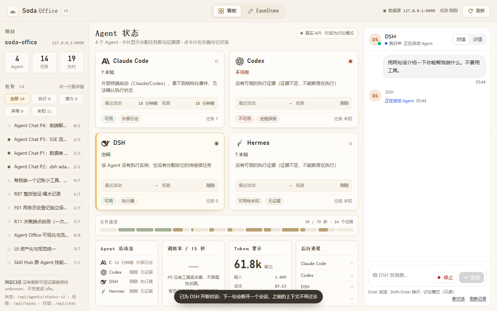
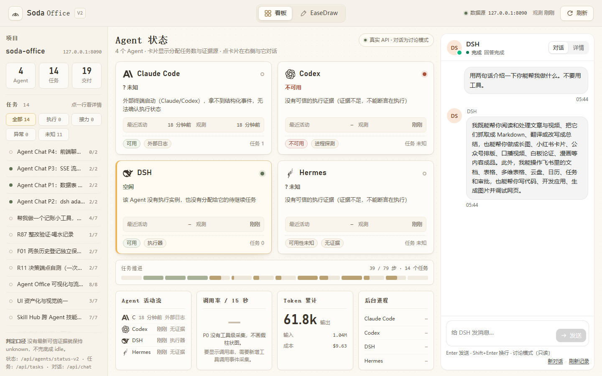
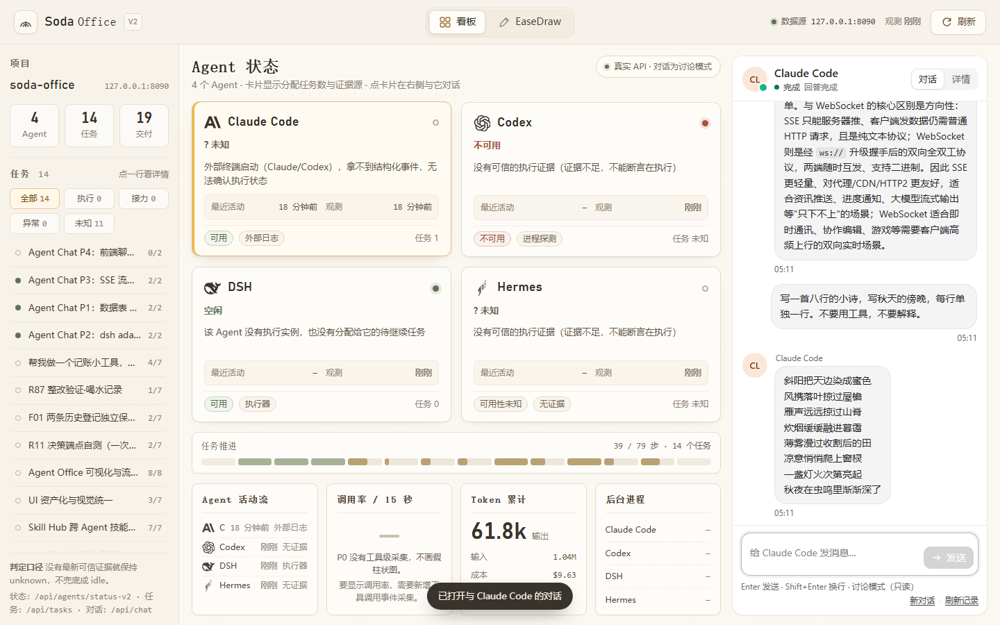
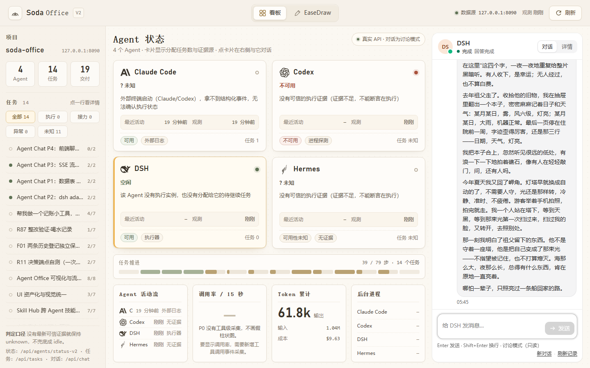
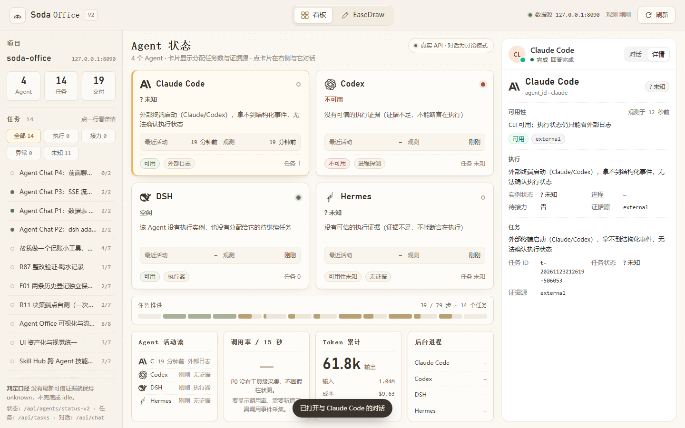
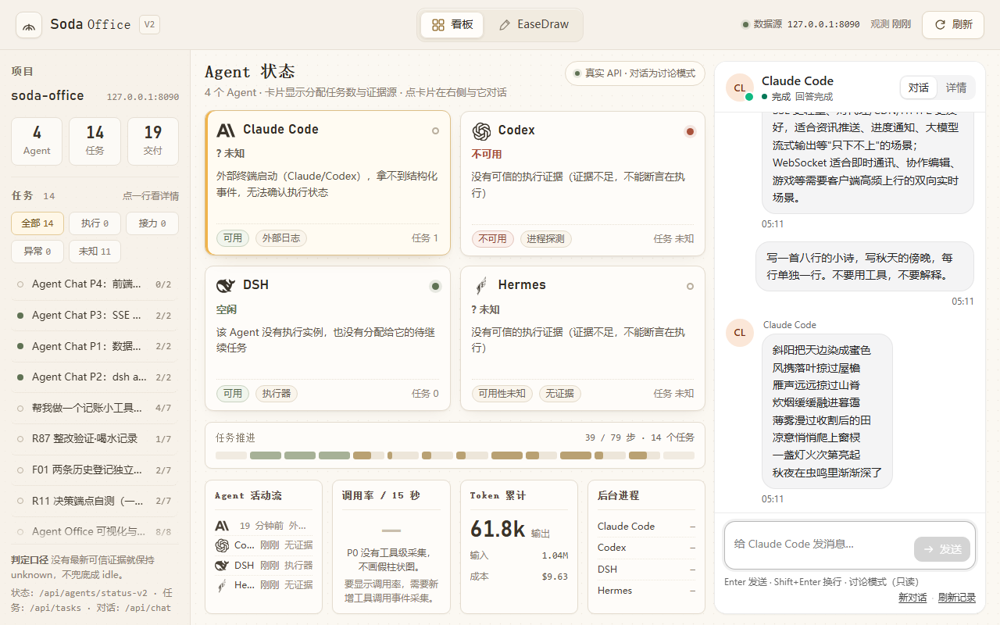
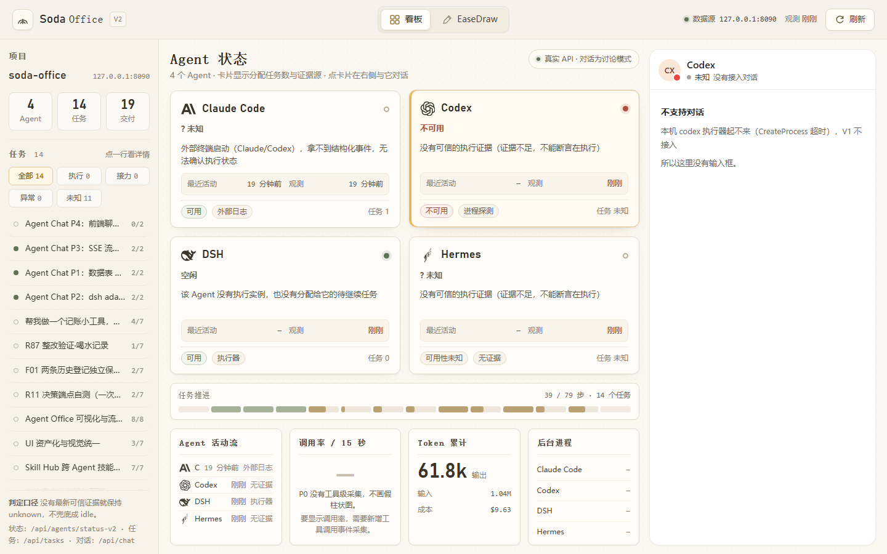
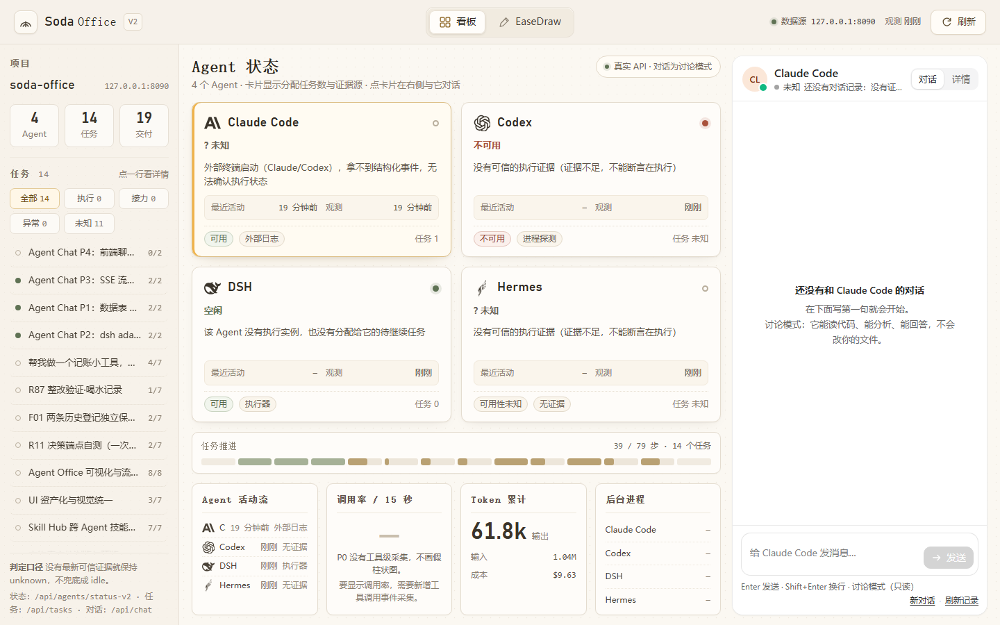

# Agent Chat P4 验收证据：前端聊天面板（Coss 风格，D1-D7）

- 日期：2026-11-23T21:46:18.619Z
- 执行人：Claude（soda-office-ba 会话，飞书触发）
- 页面：`http://127.0.0.1:8090/board-cromma.html`（真实浏览器 Chrome headless + 真实 8090 服务 + 真 CLI；dsh 真跑了 4 轮，claude 只看历史）
- 位置：`web/board-cromma.html` + `board-cromma.js`（看板右列改成整列）+ 新增 `web/board-chat.js` / `web/board-chat.css`（对话面板，Coss 参数）
- 验收脚本：`scripts/chat-v1/p4-acceptance/run.mjs`，完整输出 `scripts/chat-v1/p4-acceptance/out/run.log`；截图与本文件同目录
- Agent Office 登记：task `t-20261123212619-506053` / attempt `a-8f49bbe8-mwtrzpa6`

## 结论

| 项 | 内容 | 结果 |
|---|---|---|
| D1 | 点 agent 卡，右侧面板打开聊天 | ✅ 通过 |
| D2 | 发一条消息，能看到自己的气泡和它的回复 | ✅ 通过 |
| D3 | 切到另一个 agent，看到的是另一个对话 | ✅ 通过 |
| D4 | 刷新页面，历史消息还在 | ✅ 通过 |
| D5 | 字号实测 min >= 11px，正文 >= 13px（交脚本） | ✅ 通过 |
| D6 | 所有按钮点击有反应（交脚本逐个点） | ✅ 通过 |
| D7 | 截图 1440x900（交图） | ✅ 通过 |

D1-D7：7/7 通过；页面错误 0 个；脚本退出码 0。



## UI 参数：设计要求 vs 现场量到的计算样式

参数来自 `docs/Coss-UI-设计参数.md`，右列是验收脚本在 1440x900 页面上用 `getComputedStyle` 量到的真实值。

| 设计要求 | 现场量到 |
|---|---|
| 纯白 #FFFFFF 底，不是暖米白 | 面板 `background-color: rgb(255, 255, 255)`（看板骨架仍是 Cromma 暖米白，两套语言各管一块） |
| 边框 rgba(0,0,0,0.08) | `border: 1px solid rgba(0, 0, 0, 0.08)`；阴影 `rgba(0, 0, 0, 0.05) 0px 1px 2px 0px` |
| 卡片圆角 16px | `border-radius: 16px`；面板尺寸 366×804 |
| 气泡大圆角，收发同色，靠左右对齐区分 | 圆角 `18px`；接收底色 `rgb(244, 244, 245)` / 发送底色 `rgb(244, 244, 245)`（相同=true）；接收气泡贴左（离面板左缘 60px，含 36px 头像列），发送气泡贴右（离右缘 14px） |
| 接收消息：左对齐，36px 圆形头像 + 姓名 | 头像 `36×36`，`border-radius: 50%`，浅桃底 `rgb(251, 231, 216)` + 深色字 `rgb(122, 46, 14)`；姓名 `12px rgb(104, 104, 104)` |
| 发送消息：右对齐，不显示头像 | 发送侧有头像=false |
| 时间戳 11-12px，色 #686868 | `12px rgb(104, 104, 104)` |
| 输入框 14px，圆角 14px，最小高 48px | 字号 `14px`；圆角 `14px`；`min-height: 48px` |
| 按钮：圆角 10px、高 32px、14px/500 | 发送键 高 `32px`、圆角 `10px`、`14px / 500` |
| 分段切换：浅灰轨道 / 选中纯白 + 轻投影 | 轨道 `rgb(244, 244, 245)`；选中 `rgb(255, 255, 255)`、`rgba(0, 0, 0, 0.08) 0px 1px 2px 0px, rgba(0, 0, 0, 0.04) 0px 0px 0px 1px` |
| 字号：正文 ≥13px，辅助 ≥11px，禁止 <11px | 全页最小 **12px**（<11px 的 0 个）；正文最小 **13px**；按钮 [14] |
| 禁止：用彩色区分收发 / 大阴影 / 渐变发光 / 彩色标签堆砌 / 假按钮 | 收发同色；阴影只有 0 1px 2px；无渐变；语义色只用于状态点与错误框；按钮逐个点过（见 D6） |

## D1 点 agent 卡，右侧面板打开聊天 ✅ 通过

#detail-panel.is-chat 里的 .chat[data-agent=claude]=true；面板位置 {"x":1055,"y":81,"w":366,"h":804}；状态行=「完成回答完成」；消息 4 条


## D2 发一条消息，看到自己的气泡和它的回复 ✅ 通过

真 dsh。先点「新对话」从空的开始，再打字发送：

新对话后 0 条；打字后发送键可用=true
点发送后 1013ms 自己的气泡出现；此刻状态=「执行中正在启动 Agent」
最终状态=「完成回答完成」；回复=「我既能帮你阅读和处理文章与视频、把它们抓取成 Markdown、翻译或改写成总结，也能帮你做成长图、小红书卡片、公众号排版、口播视频、白板论证、漫画等内容成品。此外，我能操作飞书里的文档、表格、多维表格、云盘、日历、任务和审批，也能帮你写代码、开发应用、生成图片并调试网页。」
与 API 里的助手消息一致（去空白与 Markdown 记号后逐字相等）=true

刚点发送时（自己的气泡已经在，助手一侧是头像 + 姓名 + 「正在启动 Agent」，头部是「执行中」，出现「停止」键）：



回复到了之后：



## D3 切到另一个 agent，看到的是另一个对话 ✅ 通过

DSH：2 条，首条「用两句话介绍一下你能帮我做什么。不要用工具。」
Claude：4 条，首条「用三句话介绍一下 SSE（Server-Sent Events）是什么、和 WebSocket 比有」



## D4 刷新页面，历史消息还在 ✅ 通过

刷新前 claude 4 条 → 刷新后 claude 4 条，逐条相同=true；状态行=「完成回答完成」

历史全部来自 `GET /api/chat/threads/:id/messages`；本机只记「上次点开的是哪个 Agent」（`localStorage`），刷新后回到同一个 Agent 最近的对话。


## D5 字号实测（脚本） ✅ 通过

脚本：`run.mjs` 的 D5 段，遍历所有可见文本节点取 `font-size`，另查正文选择器、输入框及其 placeholder、面板内全部按钮；四种视口各量一遍。

1440x900：文本节点 176 个，分布 {"12px":108,"12.5px":2,"13px":36,"14px":16,"16px":1,"18px":6,"19px":1,"22px":3,"24px":1,"34px":1,"40px":1}；最小 12px，<11px 的 0 个
正文最小 13px（气泡 / 报错说明 / 任务标题 / Agent 卡说明）；输入框 14px；按钮字号 [14]
四种视口全部达标=true

四种视口（claude 1440x900 / dsh 1440x900 / claude 1280x800 / claude 1936x1056）的最小字号：claude-1440x900=12px，dsh-1440x900=12px，claude-1280x800=12px，claude-1936x1056=12px。完整数据 `d5-fonts.json`。

## D6 所有按钮点击有反应（脚本逐个点） ✅ 通过

脚本把页面上每个 `<button` 逐个点一遍：每点一个前重开页面、记录点击前后的完整签名（选中项 / 路由 / 列表 / 对话面板的状态行、消息数、页签、焦点、滚动位置、toast 及其计数 …），有变化才算有反应。

按钮 32 个：有反应 31，合理禁用 0（仅空输入时的发送键），无反应 0
停止：点之前「执行中正在恢复会话」→ 点之后「中断已停止」
重试：点了之后消息 6 → 8 条，状态「完成回答完成」
页面错误 0 个

| # | 按钮 | 结果 | 变化 |
|---|---|---|---|
| 0 | 看板 | ✅ 有反应 | toastCount, toast, focus |
| 1 | EaseDraw | ✅ 有反应 | hash, route, boardHidden, chatTail, focus, resources |
| 2 | 刷新 | ✅ 有反应 | toastCount, toast, focus, resources |
| 3 | 全部 14 | ✅ 有反应 | toastCount, toast, focus |
| 4 | 执行 0 | ✅ 有反应 | activeFilter, taskList, toastCount, toast, focus |
| 5 | 接力 0 | ✅ 有反应 | activeFilter, taskList, toastCount, toast, focus |
| 6 | 异常 0 | ✅ 有反应 | activeFilter, taskList, toastCount, toast, focus |
| 7 | 未知 11 | ✅ 有反应 | activeFilter, taskList, toastCount, toast, focus |
| 8 | Agent Chat P4：前端聊天面板（Coss 风格）D | ✅ 有反应 | selectedAgent, selectedTask, toastCount, toast, chatAgent, chatState, chatTab, chatMsgs, chatTail, composerHidden, detailPanelHead, focus, chatScroll |
| 9 | Agent Chat P3：SSE 流式输出（真 CLI 验 | ✅ 有反应 | selectedAgent, selectedTask, toastCount, toast, chatAgent, chatState, chatTab, chatMsgs, chatTail, composerHidden, detailPanelHead, focus, chatScroll |
| 10 | Agent Chat P1：数据表 + claude ada | ✅ 有反应 | selectedAgent, selectedTask, toastCount, toast, chatAgent, chatState, chatTab, chatMsgs, chatTail, composerHidden, detailPanelHead, focus, chatScroll |
| 11 | Agent Chat P2：dsh adapter（真 ds | ✅ 有反应 | selectedAgent, selectedTask, toastCount, toast, chatAgent, chatState, chatTab, chatMsgs, chatTail, composerHidden, detailPanelHead, focus, chatScroll |
| 12 | 帮我做一个记账小工具，能记录每笔支出、按分类统计每月花了多少 | ✅ 有反应 | selectedAgent, selectedTask, toastCount, toast, chatAgent, chatState, chatTab, chatMsgs, chatTail, composerHidden, detailPanelHead, focus, chatScroll |
| 13 | R87 整改验证·喝水记录 1/7 | ✅ 有反应 | selectedAgent, selectedTask, toastCount, toast, chatAgent, chatState, chatTab, chatMsgs, chatTail, composerHidden, detailPanelHead, focus, chatScroll |
| 14 | F01 两条历史登记独立保存验证（测完即删） 2/7 | ✅ 有反应 | selectedAgent, selectedTask, toastCount, toast, chatAgent, chatState, chatTab, chatMsgs, chatTail, composerHidden, detailPanelHead, focus, chatScroll |
| 15 | R11 决策端点自测（一次性，测完即删） 2/7 | ✅ 有反应 | selectedAgent, selectedTask, toastCount, toast, chatAgent, chatState, chatTab, chatMsgs, chatTail, composerHidden, detailPanelHead, focus, chatScroll |
| 16 | Agent Office 可视化与流程打通 8/8 | ✅ 有反应 | selectedAgent, selectedTask, toastCount, toast, chatAgent, chatState, chatTab, chatMsgs, chatTail, composerHidden, detailPanelHead, focus, chatScroll |
| 17 | UI 资产化与视觉统一 3/7 | ✅ 有反应 | selectedAgent, selectedTask, toastCount, toast, chatAgent, chatState, chatTab, chatMsgs, chatTail, composerHidden, detailPanelHead, focus, chatScroll |
| 18 | Skill Hub 跨 Agent 技能安装 7/7 | ✅ 有反应 | selectedAgent, selectedTask, toastCount, toast, chatAgent, chatState, chatTab, chatMsgs, chatTail, composerHidden, detailPanelHead, focus, chatScroll |
| 19 | 产物库文件浏览与预览 2/7 | ✅ 有反应 | selectedAgent, selectedTask, toastCount, toast, chatAgent, chatState, chatTab, chatMsgs, chatTail, composerHidden, detailPanelHead, focus, chatScroll |
| 20 | EaseDraw 专注模式接入工作台 4/7 | ✅ 有反应 | selectedAgent, selectedTask, toastCount, toast, chatAgent, chatState, chatTab, chatMsgs, chatTail, composerHidden, detailPanelHead, focus, chatScroll |
| 21 | 每日工作台日报自动生成 0/7 | ✅ 有反应 | selectedAgent, selectedTask, toastCount, toast, chatAgent, chatState, chatTab, chatMsgs, chatTail, composerHidden, detailPanelHead, focus, chatScroll |
| 22 | Claude Code ? 未知 外部终端启动（Claude | ✅ 有反应 | selectedAgent, toastCount, toast, chatAgent, chatMsgs, chatTail, focus, chatScroll, resources |
| 23 | Codex 不可用 没有可信的执行证据（证据不足，不能断言在 | ✅ 有反应 | selectedAgent, toastCount, toast, chatAgent, chatState, chatTab, chatMsgs, chatTail, composerHidden, chatScroll, resources |
| 24 | DSH 空闲 该 Agent 没有执行实例，也没有分配给它的 | ✅ 有反应 | toastCount, focus |
| 25 | Hermes ? 未知 没有可信的执行证据（证据不足，不能断 | ✅ 有反应 | selectedAgent, toastCount, toast, chatAgent, chatState, chatTab, chatMsgs, chatTail, composerHidden, chatScroll, resources |
| 26 | 对话 | ✅ 有反应 | focus |
| 27 | 详情 | ✅ 有反应 | chatTab, chatTail, composerHidden, detailHead, detailPanelHead, focus |
| 28 | 停止 | 专项另测 | 执行中才出现；下面有专项 |
| 29 | 发送 | ✅ 有反应 | toastVisible, chatMsgs, chatTail, focus, resources |
| 30 | 新对话 | ✅ 有反应 | toastCount, toast, chatState, chatMsgs, chatTail, focus |
| 31 | 刷新记录 | ✅ 有反应 | toastCount, toast, focus, resources |

专项（执行中才出现的按钮）：**停止**——给 dsh 发一篇长文，执行中点「停止」，状态从「执行中正在恢复会话」变成「中断已停止」，已收到的内容保留；**重试**——在被停止的那一轮点「重试」，消息从 6 条变成 8 条，状态「完成回答完成」。

唯一会禁用的按钮是输入框为空时的「发送」：打上字立刻可用，点下去真的发出去了（第 29 号）。

## D7 截图与版式 ✅ 通过

截图：d7-claude-1440x900.png、d7-dsh-1440x900.png、d7-claude-1280x800.png、d7-claude-1936x1056.png、d7-detail-tab-1440x900.png、d7-task-detail-1440x900.png、d7-codex-unsupported-1440x900.png、d7-new-chat-empty-1440x900.png
文字重叠总数 0；横向溢出 / 出面板的问题 0 处
未接入的 Codex：状态「未知没有接入对话」／「不支持对话 本机 codex 执行器起不来（CreateProcess 超时），V1 不接入 所以这」／有输入框=false
新对话空状态：状态「未知还没有对话记录：没有证据，不显示空闲」／消息 0 条／有输入框=true











另外 1936x1056 与任务详情两张：`d7-claude-1936x1056.png`、`d7-task-detail-1440x900.png`。

## 状态显示

头部那一行是「五态 + 说明」，气泡下面是这一轮的小字；只认证据：

| 情况 | 头部 | 依据 |
|---|---|---|
| 排队 | 排队 · 排队中（前面还有 N 条） | 轮次 status=queued，`queued_ahead` |
| 执行中 | 执行中 · 正在启动 Agent / 正在恢复会话 / 正在回答 / 正在执行工具 | SSE 的 started / restoring / status / delta |
| 完成 | 完成 · 回答完成 | 轮次 completed |
| 失败 | 失败 · Agent 启动失败（+ 具体原因）/ 中断 · 已停止 | 轮次 failed / interrupted，`error.label` + `error.message` |
| 请求受限 | 请求受限 · CLI 正在自动重试（第 3/10 次），约 2 秒后第 4 次；结束后：额度 01/01 09:30 重置，之后可以重试 | SSE retry / error 的 `retry_hint` |
| 取不到状态 | 未知 · 取不到状态：… / 还没有对话记录：没有证据，不显示空闲 | 接口失败或没有任何轮次 |
| 断流 | 横幅「连接中断，正在重连…（重连后按序号补发，内容不丢）」 | EventSource 自动重连（P5 实测） |

没有任何一处显示「空闲」。

## 本批改动

- `web/board-cromma.html` / `.css`：看板视图改成「左一整块 + 右一整列」；右列 `#detail-panel` 选中 Agent 时是对话面板（`.is-chat`），选中任务时是原来的任务详情；窄屏下数据卡标题旁的来源说明收起
- `web/board-cromma.js`：`renderDetail` 分流到对话面板；点 Agent 卡后焦点进输入框；记住上次点开的 Agent；刷新按钮同时重拉对话记录；toast 计数（自检用）；文案（不再是「只读」）
- 新增 `web/board-chat.js`：每个 Agent 一份对话状态；打开面板拉历史；发消息后立刻重拉（自己的气泡马上出现）并订阅 SSE；增量追加、状态行、工具调用提示、停止 / 重试 / 新对话 / 刷新记录；EventSource 自动重连带 Last-Event-ID，断流横幅；连不上流时退回轮询；回复按 Markdown 安全渲染（先整体转义）
- 新增 `web/board-chat.css`：Coss 参数（见上表）
- `web/server.js`：静态白名单加这两个文件
- 没做的（如实）：没有「历史对话列表」切换器（每个 Agent 打开它最近的一个对话；「新对话」另起一个）；工具调用的明细只在流式过程中显示，结束后以库里的消息为准

## 完整运行输出

```
PASS  D1  点 agent 卡，右侧面板打开聊天
      #detail-panel.is-chat 里的 .chat[data-agent=claude]=true；面板位置 {"x":1055,"y":81,"w":366,"h":804}；状态行=「完成回答完成」；消息 4 条
PASS  D2  发一条消息，能看到自己的气泡和它的回复
      新对话后 0 条；打字后发送键可用=true
      点发送后 1013ms 自己的气泡出现；此刻状态=「执行中正在启动 Agent」
      最终状态=「完成回答完成」；回复=「我既能帮你阅读和处理文章与视频、把它们抓取成 Markdown、翻译或改写成总结，也能帮你做成长图、小红书卡片、公众号排版、口播视频、白板论证、漫画等内容成品。此外，我能操作飞书里的文档、表格、多维表格、云盘、日历、任务和审批，也能帮你写代码、开发应用、生成图片并调试网页。」
      与 API 里的助手消息一致（去空白与 Markdown 记号后逐字相等）=true
PASS  D3  切到另一个 agent，看到的是另一个对话
      DSH：2 条，首条「用两句话介绍一下你能帮我做什么。不要用工具。」
      Claude：4 条，首条「用三句话介绍一下 SSE（Server-Sent Events）是什么、和 WebSocket 比有」
PASS  D4  刷新页面，历史消息还在（从 API 拉）
      刷新前 claude 4 条 → 刷新后 claude 4 条，逐条相同=true；状态行=「完成回答完成」
PASS  D5  字号实测 min >= 11px，正文 >= 13px（交脚本）
      1440x900：文本节点 176 个，分布 {"12px":108,"12.5px":2,"13px":36,"14px":16,"16px":1,"18px":6,"19px":1,"22px":3,"24px":1,"34px":1,"40px":1}；最小 12px，<11px 的 0 个
      正文最小 13px（气泡 / 报错说明 / 任务标题 / Agent 卡说明）；输入框 14px；按钮字号 [14]
      四种视口全部达标=true
      PASS  # 0 看板                     toastCount, toast, focus
      PASS  # 1 EaseDraw               hash, route, boardHidden, chatTail, focus, resources
      PASS  # 2 刷新                     toastCount, toast, focus, resources
      PASS  # 3 全部 14                  toastCount, toast, focus
      PASS  # 4 执行 0                   activeFilter, taskList, toastCount, toast, focus
      PASS  # 5 接力 0                   activeFilter, taskList, toastCount, toast, focus
      PASS  # 6 异常 0                   activeFilter, taskList, toastCount, toast, focus
      PASS  # 7 未知 11                  activeFilter, taskList, toastCount, toast, focus
      PASS  # 8 Agent Chat P4：前端聊天面板（C selectedAgent, selectedTask, toastCount, toast, chatAgent, chatState, chatTab, chatMsgs, chatTail, composerHidden, detailPanelHead, focus, chatScroll
      PASS  # 9 Agent Chat P3：SSE 流式输出 selectedAgent, selectedTask, toastCount, toast, chatAgent, chatState, chatTab, chatMsgs, chatTail, composerHidden, detailPanelHead, focus, chatScroll
      PASS  #10 Agent Chat P1：数据表 + cl selectedAgent, selectedTask, toastCount, toast, chatAgent, chatState, chatTab, chatMsgs, chatTail, composerHidden, detailPanelHead, focus, chatScroll
      PASS  #11 Agent Chat P2：dsh adap selectedAgent, selectedTask, toastCount, toast, chatAgent, chatState, chatTab, chatMsgs, chatTail, composerHidden, detailPanelHead, focus, chatScroll
      PASS  #12 帮我做一个记账小工具，能记录每笔支出、按分类 selectedAgent, selectedTask, toastCount, toast, chatAgent, chatState, chatTab, chatMsgs, chatTail, composerHidden, detailPanelHead, focus, chatScroll
      PASS  #13 R87 整改验证·喝水记录 1/7      selectedAgent, selectedTask, toastCount, toast, chatAgent, chatState, chatTab, chatMsgs, chatTail, composerHidden, detailPanelHead, focus, chatScroll
      PASS  #14 F01 两条历史登记独立保存验证（测完即删） selectedAgent, selectedTask, toastCount, toast, chatAgent, chatState, chatTab, chatMsgs, chatTail, composerHidden, detailPanelHead, focus, chatScroll
      PASS  #15 R11 决策端点自测（一次性，测完即删） 2 selectedAgent, selectedTask, toastCount, toast, chatAgent, chatState, chatTab, chatMsgs, chatTail, composerHidden, detailPanelHead, focus, chatScroll
      PASS  #16 Agent Office 可视化与流程打通  selectedAgent, selectedTask, toastCount, toast, chatAgent, chatState, chatTab, chatMsgs, chatTail, composerHidden, detailPanelHead, focus, chatScroll
      PASS  #17 UI 资产化与视觉统一 3/7        selectedAgent, selectedTask, toastCount, toast, chatAgent, chatState, chatTab, chatMsgs, chatTail, composerHidden, detailPanelHead, focus, chatScroll
      PASS  #18 Skill Hub 跨 Agent 技能安装 selectedAgent, selectedTask, toastCount, toast, chatAgent, chatState, chatTab, chatMsgs, chatTail, composerHidden, detailPanelHead, focus, chatScroll
      PASS  #19 产物库文件浏览与预览 2/7         selectedAgent, selectedTask, toastCount, toast, chatAgent, chatState, chatTab, chatMsgs, chatTail, composerHidden, detailPanelHead, focus, chatScroll
      PASS  #20 EaseDraw 专注模式接入工作台 4/7 selectedAgent, selectedTask, toastCount, toast, chatAgent, chatState, chatTab, chatMsgs, chatTail, composerHidden, detailPanelHead, focus, chatScroll
      PASS  #21 每日工作台日报自动生成 0/7        selectedAgent, selectedTask, toastCount, toast, chatAgent, chatState, chatTab, chatMsgs, chatTail, composerHidden, detailPanelHead, focus, chatScroll
      PASS  #22 Claude Code ? 未知 外部终端启 selectedAgent, toastCount, toast, chatAgent, chatMsgs, chatTail, focus, chatScroll, resources
      PASS  #23 Codex 不可用 没有可信的执行证据（证据 selectedAgent, toastCount, toast, chatAgent, chatState, chatTab, chatMsgs, chatTail, composerHidden, chatScroll, resources
      PASS  #24 DSH 空闲 该 Agent 没有执行实例， toastCount, focus
      PASS  #25 Hermes ? 未知 没有可信的执行证据（ selectedAgent, toastCount, toast, chatAgent, chatState, chatTab, chatMsgs, chatTail, composerHidden, chatScroll, resources
      PASS  #26 对话                     focus
      PASS  #27 详情                     chatTab, chatTail, composerHidden, detailHead, detailPanelHead, focus
      跳过  #28 停止                     hidden（另有专项：停止 / 条件出现的按钮）
      PASS  #29 发送                     空输入时禁用 → 打字后可用 → 点击发送
      PASS  #30 新对话                    toastCount, toast, chatState, chatMsgs, chatTail, focus
      PASS  #31 刷新记录                   toastCount, toast, focus, resources
PASS  D6  所有按钮点击有反应（交脚本逐个点）
      按钮 32 个：有反应 31，合理禁用 0（仅空输入时的发送键），无反应 0
      停止：点之前「执行中正在恢复会话」→ 点之后「中断已停止」
      重试：点了之后消息 6 → 8 条，状态「完成回答完成」
      页面错误 0 个
PASS  D7  截图 1440x900（另附 1280x800 / 1936x1056）；文字无重叠、气泡不出面板
      截图：d7-claude-1440x900.png、d7-dsh-1440x900.png、d7-claude-1280x800.png、d7-claude-1936x1056.png、d7-detail-tab-1440x900.png、d7-task-detail-1440x900.png、d7-codex-unsupported-1440x900.png、d7-new-chat-empty-1440x900.png
      文字重叠总数 0；横向溢出 / 出面板的问题 0 处
      未接入的 Codex：状态「未知没有接入对话」／「不支持对话 本机 codex 执行器起不来（CreateProcess 超时），V1 不接入 所以这」／有输入框=false
      新对话空状态：状态「未知还没有对话记录：没有证据，不显示空闲」／消息 0 条／有输入框=true

D1-D7：7/7 通过；页面错误 0 个
```

## Agent Office 登记

- `POST /api/tasks` → 201，task `t-20261123212619-506053`「Agent Chat P4：前端聊天面板（Coss 风格）D1-D7」
- `POST /api/tasks/:id/attempt` → 201，attempt `a-8f49bbe8-mwtrzpa6`
- checkpoint / finish 响应在 `scripts/chat-v1/p4-acceptance/office/`
