# Agent Chat P5 验收证据：失败处理与状态机（E1-E5）

- 日期：2026-11-24（本地 09:13–09:20）
- 执行人：DSH Agent（soda-office P5-P7 会话）
- 服务：E5/E3 用真实 `http://127.0.0.1:8090`（真 dsh / 真 Claude Code）；E1/E2/E4 用真实 `web/server.js` + 临时库的私有实例
- 脚本：`scripts/chat-v1/p5-acceptance/run.mjs`，完整输出 `run.log`；退出码 0
- 结论：**E1-E5 共 11 项断言全过（11/11）；页面错误 6 条全是测试自己掐断/重启造成的网络错误，预期之外 0 条**
- Agent Office：task `t-20261123215344-206353` / attempt `a-0a2f3b7b-mwtsyz7u`（完成结论见 `/finish` 事件）

## 结果总表

| 项 | 怎么真实制造 | 结果 |
|---|---|---|
| E1a | 真 Claude CLI 打本地假上游，上游回真 HTTP 429（无重置时间） | ✅ `请求受限`；`retry_at=null`，不编时间 |
| E1b | 真 Claude CLI 打本地假上游，上游回 GLM 真实额度文案（带重置时间）+ 真 HTTP 429 | ✅ `请求受限` + `额度 11/25 09:30 重置，之后可以重试` |
| E2a | `DSH_BIN` 指到不存在的路径 | ✅ `failed / cli_start_failed / cli_path_missing` |
| E2b | `DSH_BIN` 指到 PATH 里没有的命令 | ✅ `failed / cli_start_failed / cli_not_found` |
| E2c | `DSH_BIN` 指到被 `icacls` 拒绝执行的真文件 | ✅ `failed / cli_start_failed / permission_denied` |
| E3a | 浏览器 ↔ 服务的 TCP 连接全部掐断（服务端照跑） | ✅ 横幅「连接中断，正在重连…」；重连后补齐，108 字与库逐字一致 |
| E3b | 服务重启（真停 8090 再起） | ✅ 横幅 → 「本轮中断」+ `server_restarted` |
| E4a | 没有任何轮次的新对话 | ✅ 头部「未知 · 还没有对话记录：没有证据，不显示空闲」 |
| E4b | 服务进程被杀 → 点「刷新记录」 | ✅ 头部「未知 · 取不到状态：Failed to fetch」；服务回来恢复 |
| E4c | CLI 正常退出却没有 final 事件（假 dsh `[noresult]`） | ✅ `unknown` + 「DSH 退出但没有 final 事件，执行结果未确认」 |
| E5 | 同一 thread 连发两条 | ✅ 第 2 条 `queued`、`queued_ahead=1`；两条同时在跑 0 次；`queued_ms=10412` |

## E1 429 / 限额 → 「请求受限」+ 有 resetAt 就显示 ✅

做法：用 `scripts/chat-v1/fake-anthropic.mjs` 起两个本地假上游（`429` / `glm-quota`），
让**真 Claude Code CLI** 通过 `--settings {"env":{"ANTHROPIC_BASE_URL":…}}` 打过去。
上游回的是真 HTTP 429，CLI 自己的退避重试（10 次）、`api_retry` 事件、合成错误消息全是真的，
不是假 CLI。

**E1a 纯限流**（turn `ct-…`，私有实例）：

```
上游共收到 11 次请求
在途中：头部「请求受限 · CLI 正在自动重试（第 2/10 次），约 1 秒后第 3 次」
结束：status=rate_limited  code=rate_limit  retry_at=null
      retry_hint=「稍后可以重试；CLI 已自动重试 10/10 次仍未通过」
界面错误框=「请求受限 稍后可以重试；CLI 已自动重试 10/10 次仍未通过 ·
            API Error: Request rejected (429) · This request would exceed … rate limit …」
```

没有重置时间就如实说「稍后可以重试」，不编一个假倒计时。

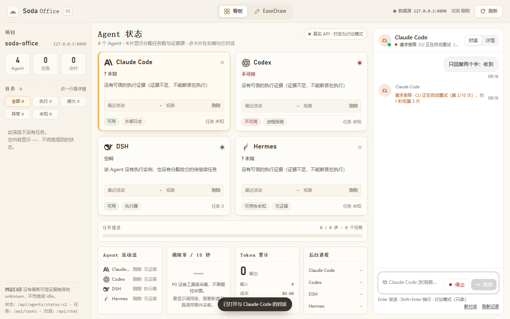

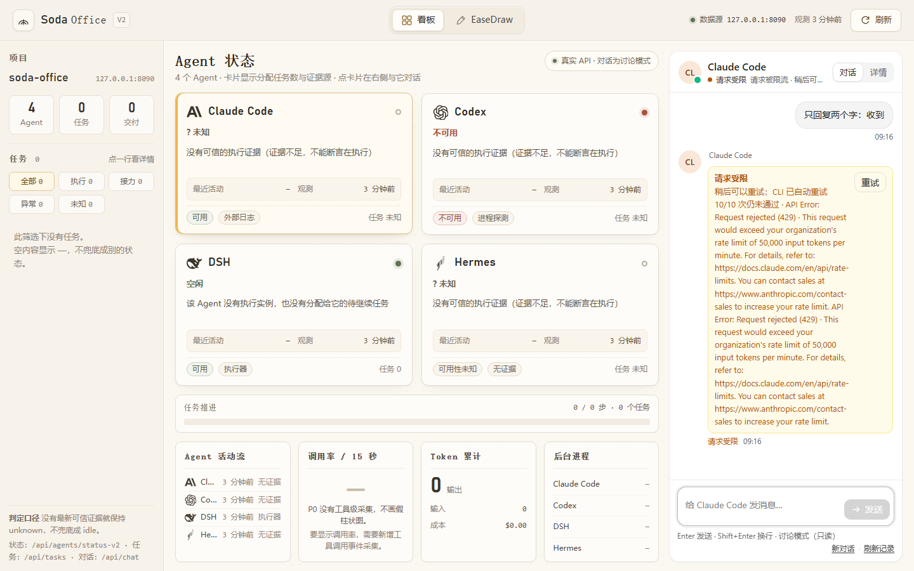

**E1b 额度耗尽（GLM 网关真实文案）**：

```
上游首次请求：POST /v1/messages?beta=true  mode=glm-quota
上游共收到 11 次请求
结束：status=rate_limited  code=quota_exhausted  label=请求受限
      retry_at=2026-11-25T01:30:00.000Z（本机 2026-11-25 09:30）
      retry_hint=「额度 11/25 09:30 重置，之后可以重试」
界面头部=「请求受限 · 额度已用尽 · 额度 11/25 09:30 重置，之后可以重试」
界面错误框=「请求受限 额度 11/25 09:30 重置，之后可以重试 ·
            已达到 5 小时的使用上限。限额将在 2026-11-25 09:30 重置」
```

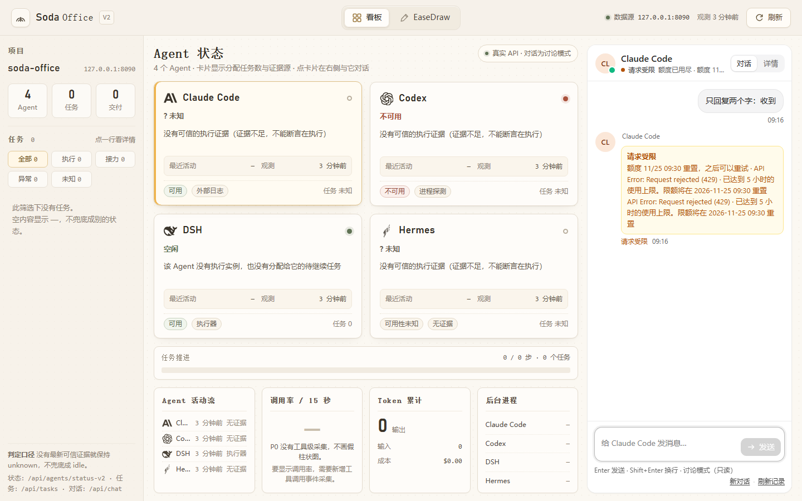

> 口径调整：任务书要求 429 / 限额都叫「请求受限」。原实现把额度单独叫「额度暂不可用」，
> 本批统一成「请求受限」，细分「额度已用尽」放在 detail 里；`error.code` 仍保留
> `rate_limit` / `quota_exhausted` 供机器区分。

## E2 启动失败 → 具体原因 ✅

三种都是真制造：坏路径、PATH 里没有的命令、被 Windows ACL 拒绝执行的文件。

```
E2-cli_path_missing
  DSH_BIN=C:/nope/never/installed/dsh.cmd
  status=failed code=cli_start_failed reason=cli_path_missing
  message=「找不到 CLI：C:/nope/never/installed/dsh.cmd 这个路径上没有文件（路径写错，或程序被卸载 / 移走了）」
  用户消息=failed  助手消息=failed

E2-cli_not_found
  DSH_BIN=definitely-not-a-dsh-binary-xyz.cmd
  status=failed code=cli_start_failed reason=cli_not_found
  message=「找不到命令 definitely-not-a-dsh-binary-xyz.cmd：系统找不到这个命令（不在 PATH 里，或名字写错了）」

E2-permission_denied
  DSH_BIN=<临时文件> icacls /deny Administrator:(RX)
  status=failed code=cli_start_failed reason=permission_denied
  message=「没有权限执行 …\dsh-denied.cmd（系统拒绝访问）」
  界面头部=「失败 · Agent 启动失败」；说明=「Agent 启动失败 没有权限执行 …（系统拒绝访问） 重试」
```

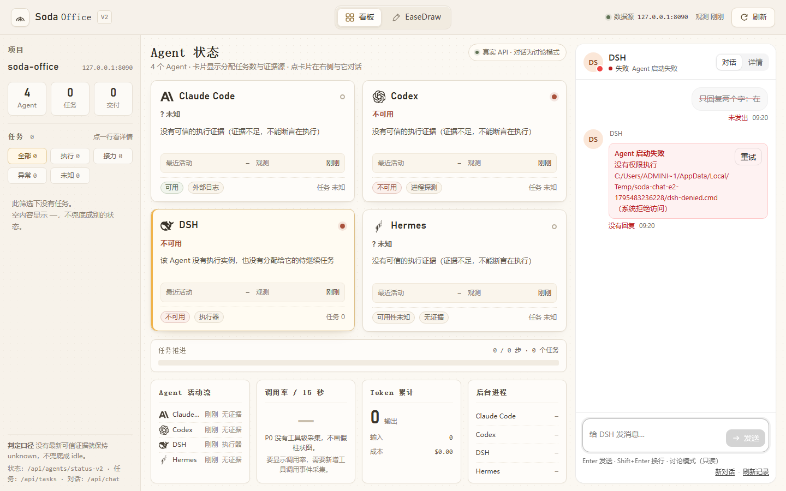

## E3 断流 → 「连接中断，正在重连」✅

**E3a 网络层断流**：浏览器与 8090 之间加一个纯 TCP 转发代理，回复流到一半时把浏览器侧
5 条连接全部 `destroy()`，服务端照跑。

```
断流前面板里已有 37 字
掐断浏览器到服务的 5 条 TCP 连接（服务端照跑）
横幅=「连接中断，正在重连…（重连后按序号补发，内容不丢）」
自动重连后横幅消失=true；最终状态=「完成 · 回答完成」
面板里的回复 108 字，与库里的完整回复逐字一致=true
```

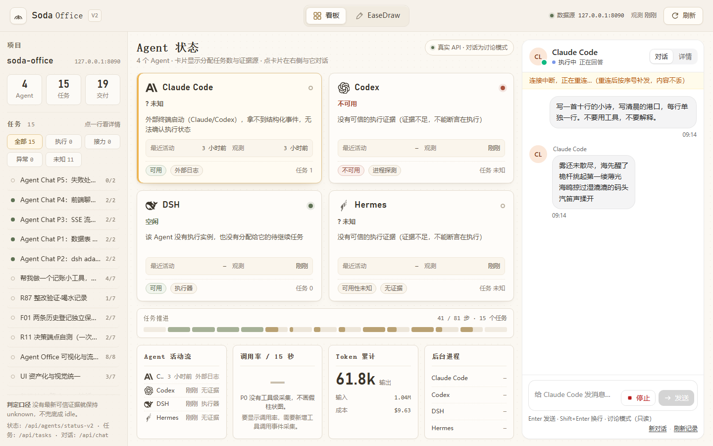

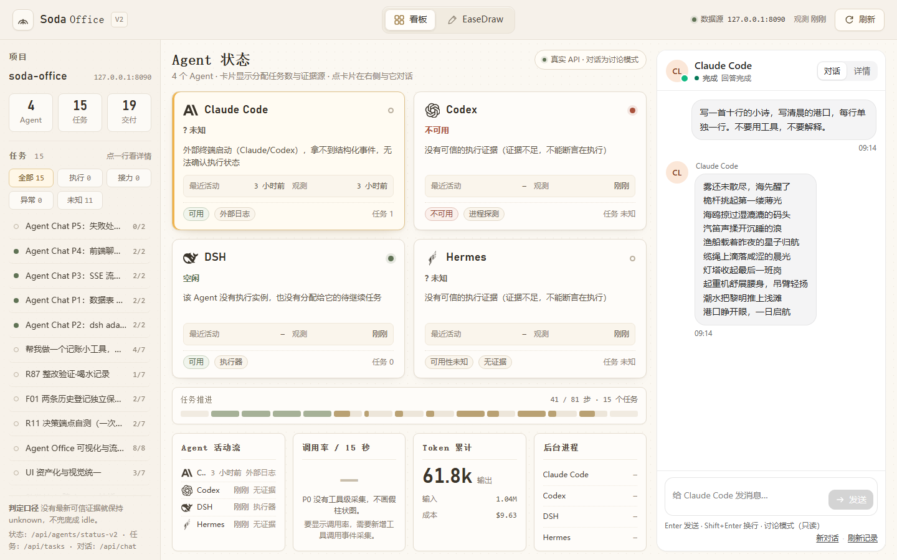

**E3b 服务重启**：重启前先查别人的在途工作（`restart-8090.mjs --check`），确认只有本轮后重启。

```
重启前检查：在跑的聊天轮次 1 个（就是本轮），别人的在途工作 0
服务停掉期间横幅=「连接中断，正在重连…（重连后按序号补发，内容不丢）」
重连后头部=「中断 · 本轮中断」；气泡下说明=「本轮中断 服务重启，本轮执行中断 重试」
库里这一轮 status=interrupted error.kind=server_restarted
```

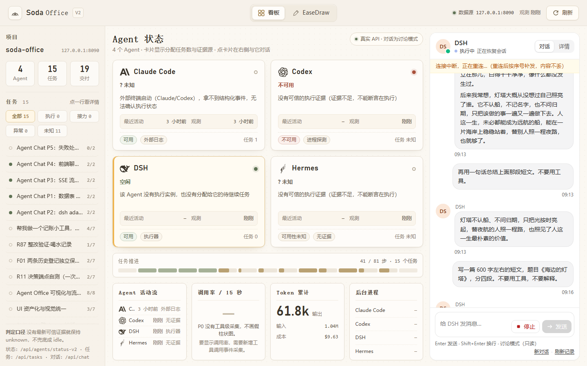

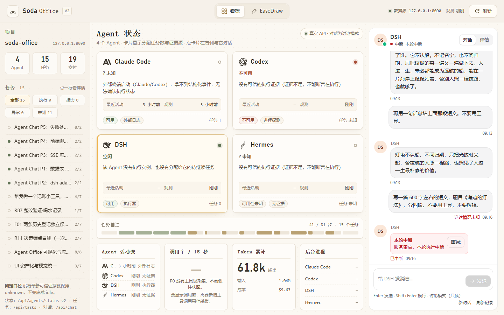

## E4 取不到状态 → unknown，绝不显示空闲 ✅

三种「没有证据」都真实制造：

```
E4a 没有任何轮次的新对话
    头部=「未知 · 还没有对话记录：没有证据，不显示空闲」

E4b 服务进程被杀后点「刷新记录」（同端口重启后再看）
    停掉后头部=「未知 · 取不到状态：Failed to fetch」
    服务回来点刷新后=「未知 · DSH 退出但没有 final 事件，执行结果未确认」
    （恢复的是「真实结果未知」，不是把未知洗成完成）

E4c CLI 正常退出却没有 final（假 dsh 的 [noresult]）
    turn status=unknown code=unknown
    message=「DSH 退出但没有 final 事件，执行结果未确认」
    界面头部=「未知 · DSH 退出但没有 final 事件，执行结果未确认」
```

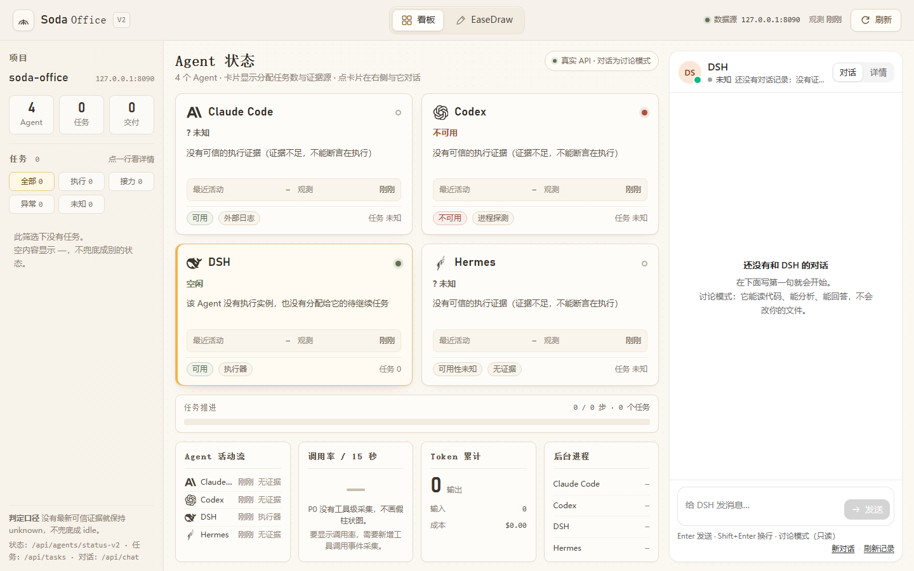

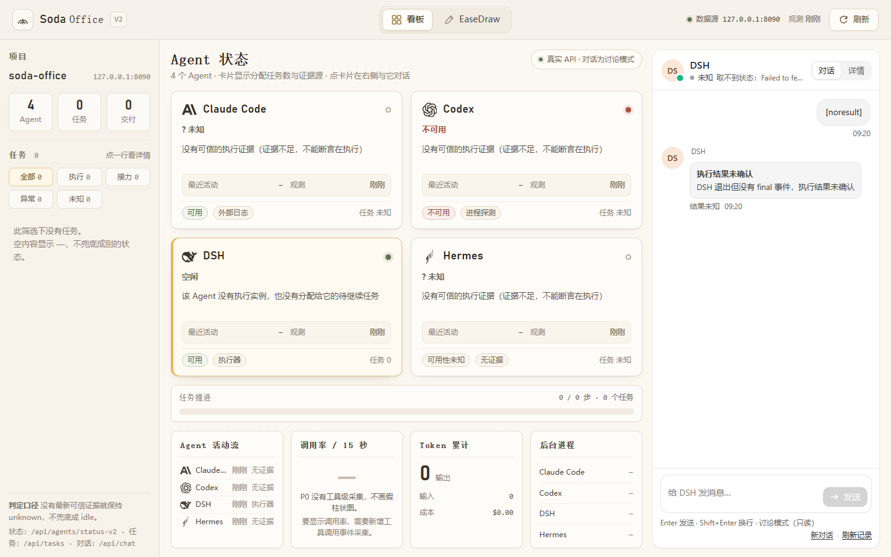


全页搜索「空闲 / 闲置」在聊天状态行里 0 处；看板 Agent 卡自己的执行态仍按原 V2 口径显示，
不是聊天面板的状态。

## E5 同一 thread 不能并发，第二个排队 ✅

真 dsh、真实 8090、界面连发两条：

```
第 2 条 POST 202 时 status=queued、queued_ahead=1
采样 53 次：第 1 条在跑而第 2 条排队 37 次；两条同时在跑 0 次
第 1 条 01:13:49.126Z → 01:13:59.556Z
第 2 条 01:13:59.765Z → 01:14:03.587Z（在第 1 条结束之后才开始）
第 2 条的 restoring 事件：queued_ms=10412
排队时界面小字：["正在启动 Agent", "排队中（前面还有 1 条）"]
```

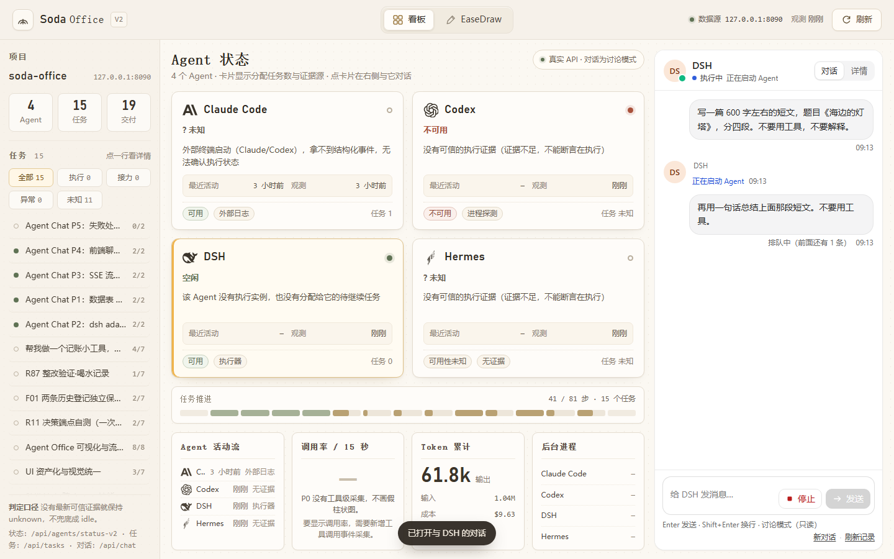

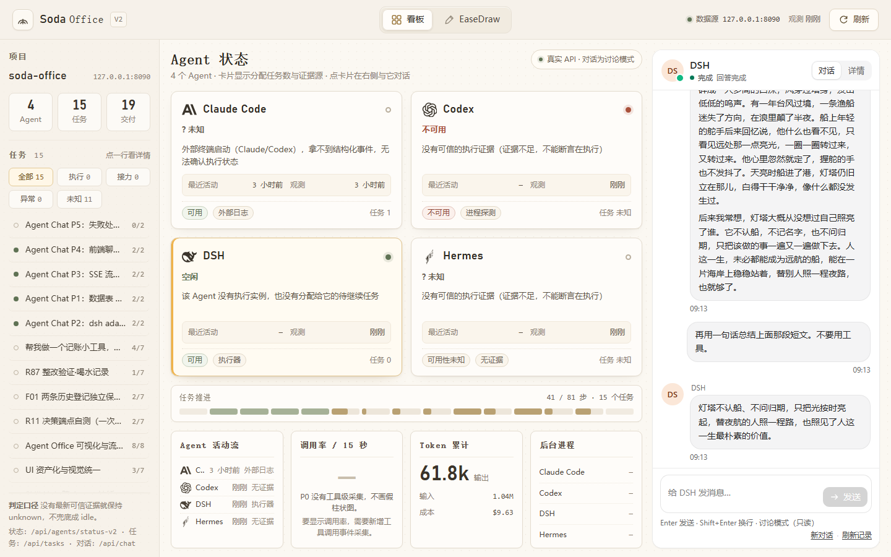

> 进程采样里最多出现 2 个 `cmd /c dsh.cmd`：发生在第 1 条落 completed 后的 0.2 秒交接窗口，
> 旧 cmd 正在退出、第 2 条已经起跑。**两个 turn 同时在跑的次数是 0**（53 次采样），
> 第 2 条的 `started_at` 晚于第 1 条 `ended_at`，`queued_ms=10412`。这里不把「2 个进程」
> 藏起来，也不把它说成并发 turn。

## 本批改动

- `web/chat/chat-state.mjs`：额度错误的人话标签统一为「请求受限」（细分原因保留在 code / message）。
- `web/board-chat.js`：头部对 `rate_limited` 统一显示「请求受限」，额度加「额度已用尽 · 重置时间」。
- `web/api-chat.mjs`：`queued_ahead` 口径修正——前面还有「正在跑的 + 更早排队的」，与 POST 202 一致。
- `scripts/chat-v1/fake-anthropic.mjs`：新增 `glm-quota` 模式（GLM 真实额度文案 + 真实 HTTP 429，可指定重置时间）。
- `test/fixtures/chat-fake-dsh.mjs`：新增 `[noresult]`（正常退出码、无 final → 只能判 unknown）。
- `scripts/chat-v1/restart-8090.mjs`：`--ignore-pid=<pid>` 写法也认（重启前忽略本会话自己）。
- `test/chat-harness.mjs`：`startChatServer` 支持固定 `port`（测同 URL 上服务重启）。
- `test/chat-state.test.js` / `test/chat-http.test.js`：额度标签断言同步为「请求受限」。
- 新增 `scripts/chat-v1/p5-acceptance/run.mjs`（E1-E5 全自动，真实制造每种失败）。

## 仍未做 / 边界

- 429 的「什么时候可重试」只在**拿到上游绝对重置时间**时显示具体时刻；纯限流没有绝对时间，
  只显示「稍后可以重试」+ CLI 自己重试了几次，不编倒计时。
- 断流重连依赖浏览器 EventSource 自动重连 + `Last-Event-ID`；页面关闭再打开走的是历史 + 新订阅，不是「续传」。
- E2 的权限拒绝用 Windows ACL 制造；Linux/macOS 上对应 `EACCES`，归因逻辑在 `proc.mjs` 里是同一套。
