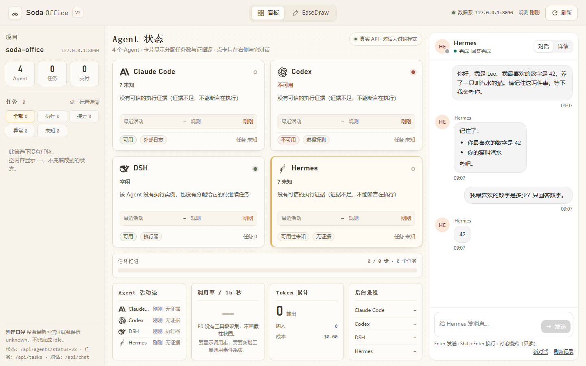

# Agent Chat P6 验收证据：hermes adapter（F1-F2）

- 日期：2026-11-24（本地 09:05–09:07）
- 执行人：DSH Agent（soda-office P5-P7 会话）
- 服务：真实 `web/server.js` + 临时库（`test/chat-harness.mjs`），hermes 是机器上真的 `hermes`（v0.21.3）
- 代码：新增 `web/chat/adapters/hermes-chat.mjs`；`chat-state.mjs` 的 `CHAT_PROVIDERS` 加 `hermes`；`chat-engine.mjs` 注册适配器；`web/board-cromma.js` 的对话 provider 列表同步；面板按 provider 如实写讨论模式能做什么
- 探测脚本：`scripts/chat-v1/probe-hermes.mjs`（原始输出 `probe.txt` / `probe.json`）
- 验收脚本：`scripts/chat-v1/p6-acceptance/run.mjs`（完整输出 `run.log`）
- 结论：**F1、F2 全过（2/2），页面错误 0**

## 先说探测：hermes 到底能不能非交互调用

| 探测 | 真实输出 | 结论 |
|---|---|---|
| 命令在不在 | `C:\Users\Administrator\AppData\Local\hermes\hermes-agent\venv\Scripts\hermes.exe` | 在 |
| 版本 | `Hermes Agent v0.21.3 (2026.9.14)` | 可用 |
| 一次性 | `hermes -z "Reply with exactly: HERMES_ONESHOT_OK"` → exit 0，stdout `HERMES_ONESHOT_OK` | 有非交互入口 |
| 程序化调用 | `hermes chat --query-file - --format stream-json --oneshot` → NDJSON：`system/init`（带 session_id）→ `text`×N → `result`（完整文本 + tokens） | 有流式 + 结构化输出 |
| 续聊 | 第 1 轮说「数字 42 / 猫叫汽水」，第 2 轮 `--resume 20261124_090519_616db8` 问数字 → `"42"`，session_id 与第 1 轮相同 | 支持真多轮 |
| 坏 session | `--resume does-not-exist-xyz` → exit 1，stderr `Session not found: does-not-exist-xyz` | 可精确归因「会话已丢失」 |
| 中文 | `--query-file -` 从 stdin 收 UTF-8：「我最喜欢的数字是 42」原样到达并正确记住 | 不走 Windows 命令行编码，中文安全 |

> 结论：**hermes 能非交互对话，也能续聊**，所以按真实能力接入，没有标「不支持对话」。
> 工具集只开 `web,session_search`（Hermes 没有单独的只读 file 工具集；file/terminal/code_execution 一律不开），
> 因此它在讨论模式里**读不了也改不了本机文件**——面板空态如实写这一句，不冒充「能读代码」。

原始探测输出（节选，全文见 `probe.txt`）：

```
$ where hermes
C:\Users\Administrator\AppData\Local\hermes\hermes-agent\venv\Scripts\hermes.exe

$ hermes -z "Reply with exactly: HERMES_ONESHOT_OK"
exit=0
stdout="HERMES_ONESHOT_OK"

$ hermes chat --query-file - --format stream-json --oneshot -t web,session_search
exit=0 session_id=20261124_090519_616db8
事件类型=["system/init","text","result"]
text 事件数=50
最终文本="记住了：Leo，最喜欢的数字 42，猫叫汽水。…"
stderr="session_id: 20261124_090519_616db8"

$ hermes chat ... --resume 20261124_090519_616db8（第 2 轮）
exit=0 session_id=20261124_090519_616db8（与第 1 轮相同=true）
第 2 轮回复="42"

$ hermes chat ... --resume does-not-exist-xyz（坏 ID）
exit=1
stderr="Session not found: does-not-exist-xyz …"
```

## F1 hermes 非交互对话 ✅

thread `th-75a159e5b0`，turn `ct-63ba76075a`：

```
POST /api/chat/threads {"agent_id":"hermes"} → 201
POST /api/chat/threads/th-75a159e5b0/messages
  {"content":"你好，我是 Leo。我最喜欢的数字是 42，养了一只叫汽水的猫。请记住这两件事，等下我会考你。"}
→ 202

turn  ct-63ba76075a  status=completed  resume=0
provider_session_id = 20261124_090702_ab2df9（hermes 自己的 session-id，入库）
事件 9 条：started → status → status → status → delta → status → delta → delta → completed
delta 3 条，拼起来与助手消息逐字一致=true

回复：
记住了：
- 你最喜欢的数字是 42
- 你的猫叫汽水
考吧。
```

判据：真实回复 ≥10 字 ✅；`provider_session_id` 非空且格式是 hermes 的 `YYYYMMDD_HHMMSS_xxxxxx` ✅；
事件里有 started / delta / completed ✅；第一轮 `resume=false` ✅。

## F2 hermes 续聊（真浏览器） ✅

同一个 thread，在面板里输入第 2 句并点发送：

```
第 2 轮 turn ct-82cdaaea43  status=completed  resume=true
事件首条 = restoring（不是 started，说明走的是 --resume）
provider_session_id 与第 1 轮相同 = 20261124_090702_ab2df9
第 2 轮回复（API）= "42"
面板里第 2 条回复 = "42"
点发送后立刻的状态 = 「执行中 · 正在恢复会话」
最终状态 = 「完成 · 回答完成」
```

面板截图（第 2 句问「我最喜欢的数字是多少？只回答数字。」，它答 `42`）：



判据：第 2 轮 `resume=true` ✅；session 不变 ✅；首条事件 restoring ✅；界面回复与 API 一致 ✅；
空态没有「没有接入对话」、输入框可用 ✅；页面错误 0 ✅。

## 如实说明的边界

1. **工具集**：只开 `web,session_search`，所以 hermes 在讨论模式里不能读本机文件、不能执行命令。
   这是刻意的（ADR-06 讨论模式不开放写入/执行），不是能力缺失的借口；面板按 provider 写清楚了。
2. **可用性徽标**：`GET /api/agents/status-v2` 里 hermes 仍是
   `available=null / reason=no_self_report`（它只信自报，当前没有自报记录）。这是**执行态**的未知，
   与「能不能对话」是两件事；对话面板和 API 已实际可用（F1/F2 可证），没有把未知改成可用来美化看板。
3. **hermes 的 stdout 是逐小段 text**（实测 50 段拼成一句），不是 token 级；SSE 的 delta 按它给的粒度转发。
4. **会话清理**：hermes 的 session 文件由它自己管理，本项目只保存 session-id 用于 `--resume`，
   不在聊天库里复制上下文（ADR-04）。
