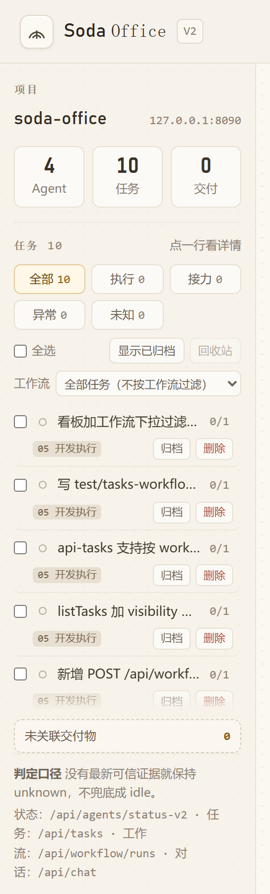

# 05c 返工报告：任务归档 / 删除 / 恢复（Codex 评审 6.9 分 → 返工）

> run: `3d22e663-a27f-417c-829b-b6b7fbcc5fad` · 步骤 05c 返工
> 依据：`docs/runs/run-3d22e663/07-review.md`（P1-1 ~ P1-4、P2-1 ~ P2-3）与任务书的 C1–C8
> 执行：2026-11-24 23:44 ~ 2026-11-25 01:30，Claude（会话 `claude.exe -p`，PID 29908）
> 追问：2026-11-25 01:35 ~ 02:10，同一会话，显示层四个问题（D1–D5）。**结果在第九节**；第一节到第八节是第一轮返工的内容，原样保留（其中「线上现状」一节写的是 01:30 那一刻的情况，之后 8090 已被重启过一次，现状以第九节为准）。08:17 任务书被原样重新派发了一次，复查过现场并补跑了一遍，记在 9.5 末尾。

**先说结论，逐条，不写「全部修复」：**

- **追问的四个显示层问题都改了，D1–D5 都过（各 5 次 5 过）；但只有「筛选分类」已经在线上生效，另外三个要再重启一次 8090。** 详见第九节。

- **P1-1 修了**。切状态筛选即清空选择；提交前再和可见行取交集；列表刷新后不再可见的行自动摘掉勾选。C1 过（5 次全过）。
- **P1-2 修了**。已软删的任务 attempt / handoff / checkpoint / finish 一律 409 `TASK_DELETED`；检查与建实例行同一个事务。C2 过（5 次全过，多进程竞态 300 轮无一例「已删除却在运行」）。
- **P1-3 修了**。恢复仍写回 `archived_from`，然后按最新执行证据重算并落库；删除守卫改看执行证据。A5 的断言一字未动。C3 过（5 次全过）。
- **P1-4 修了**。归档 / 恢复 / 删除各自一个事务；批量仍逐条事务。C4 过（5 次全过）。
- **P2-1 修了，但有一个前提没满足**：停止已接真实执行器的停止路径并等进程退出；**可线上没有任何入口会在服务进程内启动托管执行**，所以这条路目前只有测试走得到。真实任务走的是另外两条（见第二节）。C5 过（5 次全过）。
- **P2-2 修了**。左栏加了「回收站」，单条恢复 + 批量恢复。C6 过（5 次全过）。
- **P2-3 修了**。C8 过（5 次全过；评审自己的并发探针复跑 108 个首请求 0 失败）。
- **C7 过**：上一版 12/12、17/17，5 次都是。
- **没做到 / 线上还没生效的**：① 8090 **没有重启**，后端修复线上未生效（前端已经是新的，相关按钮已做禁用降级）；② 上面 P2-1 的前提；③ 非本服务启动、进程还活着的执行，本服务不代杀（有意为之）；④ g02 / g07 的 10 条历史失败没动。

---

## 〇、验收标准 C1–C8 逐条结果

| # | 标准 | 过没过 | 测了几次、过几次 | 证据 |
|---|---|---|---|---|
| C1 | 切筛选后选择被清空，或提交的 ids 只有可见的 | 过 | 5 次全过（真实 Chrome 点击 + 抓批量请求的 ids） | `tasks-rework-after-run1..5.log`，截图 01 / 02 / 02b |
| C2 | 已删除任务不能创建 attempt | 过 | 5 次全过；另有 2 个真实服务进程各 60 轮并发「删除 vs 启动」，5 次共 300 轮 | 同上，`C2` / `C2b` |
| C3 | 归档期间完成后恢复，状态 / 实例 / 可删除性一致 | 过 | 5 次全过（4 个场景：完成、停止、进程消失、状态列已过期的坏行） | 同上，`C3` / `C3b` / `C3c` / `C3d` |
| C4 | 事件写失败时主记录必须回滚 | 过 | 5 次全过（归档 / 恢复 / 删除各一次 + 批量部分失败 + 托管停止的审计写失败） | 同上，`C4` / `C4b` |
| C5 | 停止动作能终止真实执行 | 过，带说明 | 5 次全过。说明：「界面点停止 → 托管进程真的退出」这一段是在**进程内夹具**上验的（夹具挂的是同一份生产路由和同一个生产执行器），因为线上服务进程里没有启动托管执行的入口 | 同上，`C5` / `C5b` / `C5c` / `C5d`，截图 03 ~ 10 |
| C6 | 删除后可重新列出并恢复 | 过 | 5 次全过（接口 + 界面：回收站、批量恢复、单条恢复） | 同上，`C6 接口` / `C6 界面`，截图 11 ~ 14 |
| C7 | 上一版 29 条（12 + 17）仍全过 | 过 | 5 次都是 12/12、17/17 | 同上，`C7` 的两行 diagnostic |
| C8 | P2-3 并发锁：明确说明修没修；修了给并发验证 | 修了，过 | 5 次全过：8 个真实服务并发首开新库 ×3 轮、并发升级 v7 库 ×2 轮，每次 0 个失败；评审的原探针复跑 108 个首请求 0 失败 | 同上，`C8` / `C8b`；`rework-race.log` |

另外自己加了三条不在任务书里的护栏用例，也都过（5 次全过）：`C1b`（在「执行」筛选下停掉一条已勾选的任务，勾选跟着消失）、`C4b`（托管停止的审计事件写失败 → 进程不动）、`C10`（服务端没重启时「停止」「回收站」禁用并说明）；`C9` 是界面用例全程无未捕获 JS 异常。

**修之前先拿同一套用例打了一遍旧代码**（`tasks-rework-before.log`，当时 18 条）：18 条里 16 条失败，只有 C7、C9 过。每一条都失败在它要验的那个缺陷上（例如 C2b 60 轮里 57 轮「删除和启动同时成功」、C4 归档报 500 但 `archived_at` 已落库、C8 首轮 16 个首请求 7 个 500）。原始输出见第三节。

---

## 一、开工前的现场核对

- **同行**：`ListAgents` 看到 4 个 Claude 会话（中途变成 5 个，新来的那个名字带 engvm，不是这个仓库的），全部 idle / waiting；进程表里带本仓库路径的只有我这个会话和 8090。要改的 7 个文件 mtime 都停在 22:16 ~ 22:53（上一个会话留下的），开工时已 50 分钟没人动。全程没有发现别人同时改这些文件。
- **8090**：PID 47292，2026-11-24 23:32:14 启动，跑的是**返工前**的后端代码。本次没有重启（见第五、六节）。
- 开工 4 分钟后（23:48）有另一个会话往这个 run 目录写了 `04-task-specs-ALL.md`（「本轮全部任务书，待 Leo 确认」）。它没有碰任何代码文件；我改的 7 个文件在 23:44 之后只有我写过（逐个核对了 mtime）。
- **Memorix**：`memorix_project_context` 的调用权限被拒，没有拿到项目记忆简报，直接按评审报告做。
- **上一版的约束先弄清楚**：`test/tasks-workflow-link.test.js` 的 B1 断言 `SCHEMA_VERSION === 9`，B10 断言 `tasks-archive.test.js` 恰好 12 条。所以这次**没有加数据库迁移**（版本仍是 9），新用例全部放进新文件 `test/tasks-rework.test.js`，`tasks-archive.test.js` 一字未动。

---

## 二、逐项：为什么是问题、怎么修的、怎么验的

### P1-1 状态筛选后批量操作会作用到不可见任务

**为什么是问题**：行被筛走了，勾选还留在集合里，批量条照常显示「已选 N 条」，点下去发的是整个集合。

**修法（两个选项都做了，外加一层）**：

1. 切状态筛选时清空选择 —— `web/board-cromma.js:1981`（点击筛选按钮的处理）。切的是同一个筛选则不动。提示语会写「已清空之前的选择」。
2. 提交前与当前可见行取交集 —— `web/board-cromma.js:1240`（`runBatchAction`）。被排除的条数会在提示里说明。
3. 渲染时把不在当前可见行里的 id 从集合里摘掉 —— `web/board-cromma.js:891`（`syncTaskSelectionUi`）。这是同一类问题的另一个来路：不是用户切筛选，而是列表刷新后某一行不再符合当前筛选（比如在「执行」下把它停掉了）。

选「清空」而不是「展示已选清单」：清空之后用户看到的就是自己选的，不需要再解释一份看不见的清单。

**怎么验的**：C1 在真实 Chrome 里勾两条 → 切「执行」→ 断言看不见的那行 gone、批量条收起、`selectedTaskIds.size === 0` → 重新勾可见的那条 → 再往集合里硬塞一条不可见的 id → 点批量归档 → 抓到的请求体 `ids` 恰好只有可见那条，库里看不见那条 `archived_at` 仍是 NULL。C1b 验第 3 层。

### P1-2 已软删任务仍可开始执行

**修法**：

- 新增 `requireNotDeletedTask`（`web/lib/tasks.mjs:253`），执行入口统一用它。
- `POST /api/tasks/:id/attempt`（`web/api-tasks.mjs:1090`）：检查没被删 → 抢写入权 → 建实例行，三步在同一个事务里。
- 删除端（`web/api-tasks.mjs:404` 的 `deleteOne`）同样在事务里查有没有 running 的实例。
- 「执行入口」我按字面理解成四个：`attempt`、`handoff`（会新建一个 running 实例）、`checkpoint`、`finish`，四个都对已删除任务返回 409 `TASK_DELETED`。恢复之后可以重新执行。执行器本身 `startDshAttempt` 也拒绝对已删除任务起实例（`web/adapters/dsh.mjs:277`）。
- 为了能「检查 + 调一个自己会开事务的函数 + 自己的写入」放进一层事务，`web/lib/db.mjs:604` 的 `transaction()` 改成可嵌套（内层落成 SAVEPOINT）。不嵌套时行为和以前完全一样。

**怎么验的**：C2 走完整序列（删 → attempt 409；有过执行且已完成的任务删掉后 handoff / finish / checkpoint / attempt 四个都 409，库里不许多出实例、检查点、写入权记录；恢复后 attempt 201）。C2b 起两个真实服务进程指向同一个库，60 轮同时发 `DELETE` 和 `POST attempt`，断言每轮恰好一方成功，另一方拿到对应错误码，库和响应一致。

### P1-3 恢复旧状态导致「已完成却不能删」

**修法**：

- `restoreOne`（`web/api-tasks.mjs:368`）：仍然写回 `archived_from`（基线要求），**紧接着**调用状态机按最新执行证据重算并落库。实例还活着时（A5 那种）重算结果就是原状态，什么都不变。事件 `task_restored` 里同时记下 `status_restored`（写回的）和 `status_after`（重算后落库的）。
- `deleteOne`（`web/api-tasks.mjs:404`）：不再看 `tasks.status` 这一列。先让状态机对齐（进程已经没了的 running 实例会在这一步落成 interrupted），再问「还有没有 running 的执行实例」，有才 409。
- `GET /api/tasks/:id`（`web/api-tasks.mjs:936`）：状态列落后于证据时，读一次详情就对齐一次；只在确实不一致时才写。

**A5 的断言一字未改**（`tasks-archive.test.js` 没动），它仍然是过的。

**怎么验的**：C3 走评审给的那条序列 running → 归档 → finish passed → restore，断言响应、库里状态列、详情的 state / view / task 三处都是 completed，没有活跃实例，`DELETE` 200。C3b（归档期间停止）、C3c（归档期间进程消失）、C3d（模拟返工前留下的坏行：状态列写着 running、没有任何实例 → 能删）。

### P1-4 主记录与审计事件非原子

**修法**：`archiveOne` / `restoreOne` / `deleteOne` 各自包进一个事务（读取、校验、更新、事件）。批量接口不变，仍是逐条调用、逐条事务、允许部分失败。停止的审计也一样：托管停止是「先把停止请求记进审计，再去停」，审计写不进去就不停（`web/api-tasks.mjs:470` 的 `stopOne`）。

**怎么验的**：C4 用评审同款的故障注入（`BEFORE INSERT ON events ... RAISE(ABORT)`）：归档 / 恢复 / 删除各 500，主记录逐字段和操作前一致，被拒的事件数为 0；批量只拦其中一条 → 那条报失败且没写，另一条成功且真写了。C4b：托管停止的 `task_stopped` 事件被拦 → 500，进程还活着、实例仍是 running、没有事件；拿掉注入后同样的停止成功。

### P2-1 界面上没有「停止」

**修法**：

- 执行器 `startDshAttempt` 起的实例登记进一张进程内的表（`web/adapters/dsh.mjs:231`），进程退出时注销（`:481`）。
- 新路由 `POST /api/tasks/:id/stop`（`web/api-tasks.mjs:1022` → `stopOne`）。按「本服务能确认到什么程度」分三种：
  - **托管**（本进程用执行器起的）：先记审计 → 调执行器的 `stop('user_stop')` → 等到进程退出 → 回库核对实例行和 pid → 才回「已停止」。
  - **别处启动、登记了 pid**：pid 还活着 → 409 `STOP_NOT_MANAGED`，本服务不代为结束别人的进程，告诉用户去哪里停、停完再点一次。那时请求开头的对账会发现进程已退出，把实例落成中断，停止路由回「已停止」。
  - **别处启动、没登记 pid**：本服务没有任何可观测的进程 → 409 `STOP_UNVERIFIED`，必须带 `confirm=true` 再调一次；确认后把实例记为 interrupted / user_stop，事件里写明「用户确认，未经系统验证」。
  - 三种都不写验收结论，任务不会因为停止变成 completed。
- 界面：有执行实例在跑的行上出现「停止」；第二种情形按钮变成「确认已停止」，再点一次才带 confirm（`web/board-cromma.js:942`、`:1193`）。
- 服务端没重启时「停止」禁用，悬停提示写明原因（见 C10）。

**怎么验的**：C5 用生产执行器 `startDshAttempt` 起一个真实的长跑进程（`test/fixtures/tasks-longrun-worker.mjs`，一个真的操作系统进程，不调用模型），`POST stop` 之后断言：pid 已不存在、进程的输出计数不再增长、实例 `interrupted / user_stop`、有 `process_exit`、执行器登记表里没有它、没有验收事件；停之前 `DELETE` 409，停之后 200。C5d 是同一条链路从界面点「停止」走一遍。C5b / C5c 验另外两种情形在界面上的表现。

### P2-2 软删后界面找不回

**修法**：左栏加「回收站」开关，真请求 `GET /api/tasks?only_deleted=1`（服务端 SQL 过滤，`web/lib/tasks.mjs:285` 的 `visibility = 'deleted'`）。回收站里每行「已删除」标签 + 「恢复」；批量条只剩「恢复」；「显示已归档」在回收站里禁用。归档和删除是两个入口，各自恢复。

**怎么验的**：C6 接口 + C6 界面（行内删除 → 进回收站看到 3 条 → 批量恢复 1 条 → 批量恢复 2 条 → 删一条再用行内「恢复」→ 退出回收站四条都回到普通列表，逐条查库 `deleted_at` 为 NULL）。

### P2-3 多进程首开库锁冲突

**根因有两层，第一层修完探针还是红**：

1. `busy_timeout` 设在 `journal_mode = WAL` 之后 —— 挪到最前面（`web/lib/db.mjs:510`）。
2. 挪完之后复跑评审的探针仍然是 6/20、10/20、7/20 个 500。挂了个诊断钩子把出错的 SQL 打出来，全部出在 `PRAGMA journal_mode = WAL` 这一句：切 WAL 要改文件头，SQLite 会在「自己已经拿着读锁」的状态下去拿写锁，这时如果别的进程正拿着写锁，它为了避开死锁**直接**返回 SQLITE_BUSY，不调用 busy handler，`busy_timeout` 设多大都没用。处理（`web/lib/db.mjs:485` 的 `enableWal`）：文件已经是 WAL 就不碰这条 PRAGMA（看文件头第 18 / 19 字节）；确实要切又撞上了就退让重试，最多等 5 秒。
3. 迁移本身：每个版本各占一个 `BEGIN IMMEDIATE` 事务，拿到写锁后在事务里重读版本，别人迁过就跳过（`web/lib/db.mjs:566`）。已经是最新版本的库只读一次版本号就返回，不写任何东西。

**怎么验的**：C8（8 个真实服务同时首开同一个新库 ×3 轮）、C8b（8 个真实服务同时升级一个 v7 形状、带旧行的库 ×2 轮，断言版本到 9、旧行逐列不变、rowid 不变、三个索引都在）。评审的原探针 `first-open-race.mjs` 原样复跑：10 个服务 ×3 轮 + 12 个服务 ×2 轮，全部 0 个失败。

---

## 三、真实测试输出

### 3.1 修之前：同一套用例打旧代码（`tasks-rework-before.log`）

```text
✔ C7 上一版两个测试文件仍全过：tasks-archive 12/12、tasks-workflow-link 17/17 (8432.1942ms)
✔ C9 界面用例全程没有未捕获的 JS 异常（pageerror / console error） (0.375ms)
ℹ tests 18
ℹ suites 0
ℹ pass 2
ℹ fail 16
ℹ cancelled 0
ℹ skipped 0
ℹ todo 0
ℹ duration_ms 47199.4379
exit=1
```

（这是 2026-11-25 00:12 跑的，当时测试文件是 18 条；之后又加了 C1b、C4b、C10 三条，这三条没有在旧代码上跑过。）

失败的 16 条各自卡在（下面是**整理**：每条取它那句断言和实测值，不是逐字原文；逐字的在日志里）：

```text
C1   切筛选后批量条必须收起            false !== true
C2   已删除任务 POST attempt 必须 409    实际 201
C2b  库里不许有「已删除却在运行」的执行实例   57 !== 0        （60 轮）
C3   恢复响应里的当前状态应是 completed    实际 running
C3b  POST /api/tasks/…/stop 不存在        404 !== 409      （路由不存在）
C3c  进程已经没了，恢复后应是 interrupted  实际 running
C3d  读详情时把过期的状态列对齐到证据      running !== completed
C4   archive：事件写失败后主记录必须原样    archived_at: null → '2026-11-24T16:12:13.430Z'
C5   POST /api/tasks/…/stop 不存在         404 !== 200
C5b  有执行实例在跑的行必须有「停止」按钮   0 !== 1
C5c  （没有停止按钮可点）
C5d  托管执行在跑的行必须有「停止」        0 !== 1
C6 接口  响应回显 only_deleted             undefined !== true
C6 界面  删除后的提示里等不到「回收站」字样   Timeout 15000ms
C8   第 1 轮有请求失败：16 个首请求里 7 个 500
C8b  第 1 轮有请求失败：16 个首请求里 10 个 500
```

### 3.2 修之后：连跑 5 次（`tasks-rework-after-run1..5.log`）

第 1 次的原文（`tasks-rework-after-run1.log` 前 39 行，未删减；中间那行 `[错误]` 是 C4b 故意注入的失败，夹具按 `server.js` 的格式把它打出来）：

```text
# 返工后 · 第 1 次 · 2026-11-25 01:06:36
# 命令：node --no-warnings --test test/tasks-rework.test.js（临时库；接口用例打真实 web/server.js 子进程；界面用例打真实服务 + web/ 下的前端；C5 托管走进程内夹具）
✔ C1 切换状态筛选后选择被清空，批量归档只提交当前可见的 ids (1628.115ms)
✔ C1b 在「执行」筛选下停掉一条已勾选的任务：它被筛出列表后，勾选跟着消失 (999.1276ms)
✔ C2 已软删的任务不能再开始执行：attempt / handoff / finish / checkpoint 一律 409 TASK_DELETED (58.4318ms)
✔ C2b 先删后启动的多进程竞态：删除与启动同时到达，恰好一方成功，不留「已删除却在运行」的任务 (1051.5195ms)
ℹ C2b 60 轮：删除先赢 49，启动先赢 11，同时成功 0，都失败 0；库里「已删除却在运行」0 条
✔ C3 running → 归档 → finish passed → restore：状态、实例、可删除性一致，恢复不伪造活跃实例 (35.8564ms)
✔ C3b running → 归档 → 停止 → restore：恢复后是「已中断」，不是「执行中」，可以删除 (18.8814ms)
✔ C3c 归档期间进程消失 → restore：恢复后不是 running，可以删除 (39.8115ms)
✔ C3d 删除守卫读执行证据，不读可能过期的 status 列：status=running 但没有运行中的实例 → 能删 (16.9871ms)
✔ C4 归档 / 恢复 / 删除的事件写失败 → 500，且主记录一行都不变；批量仍逐条事务、允许部分失败 (39.8558ms)
[错误] POST /api/tasks/t-20261124170640-34f183/stop → ERR_SQLITE_ERROR: rework: injected stop audit failure
✔ C4b 托管停止：停止请求的审计事件写不进去 → 500，进程不动、实例仍是 running、没有事件 (600.4905ms)
✔ C5 托管执行：POST stop 走执行器的停止路径，进程真的退出、实例落成 user_stop，之后才能删 (1687.5194ms)
ℹ C5 托管执行 pid=34944 attempt=a-eebec37b-mwuy5o0b：停止后 600ms 内输出计数停在 4；实例 interrupted/user_stop
✔ C5b 界面：别处启动、登记了 pid 的执行 → 本服务不代杀，给出可操作的停止路径；进程退出后确认并允许删除 (1032.9427ms)
✔ C5c 界面：别处启动、没登记 pid 的执行 → 必须二次确认才记为「用户停止」（不写验收），之后才能删 (950.1878ms)
✔ C5d 界面：点「停止」真的结束一个托管执行（进程退出 + 实例结束），然后才能删 (1977.9359ms)
✔ C6 接口：GET /api/tasks?only_deleted=1 只返回已删除的；单条 / 批量 restore 清掉 deleted_at (82.3992ms)
✔ C6 界面：回收站入口列出已删除任务，批量恢复 + 单条恢复 (1395.7442ms)
✔ C7 上一版两个测试文件仍全过：tasks-archive 12/12、tasks-workflow-link 17/17 (6688.1731ms)
ℹ test/tasks-archive.test.js：tests 12，pass 12，fail 0，exit 0
ℹ test/tasks-workflow-link.test.js：tests 17，pass 17，fail 0，exit 0
✔ C8 多进程并发首开同一个「还不存在」的新库：全部 200，无 database is locked (1466.9916ms)
ℹ C8 新库 第 1 轮：8 个服务 × 2 个首请求，non-200 = 0/16
ℹ C8 新库 第 2 轮：8 个服务 × 2 个首请求，non-200 = 0/16
ℹ C8 新库 第 3 轮：8 个服务 × 2 个首请求，non-200 = 0/16
ℹ C8 新库 合计 3 轮：48 个首请求，失败 0 个
✔ C8b 多进程并发升级 v7 形状的旧库（v8、v9 两个迁移一起抢）：全部 200，旧行逐列不变、rowid 不变 (980.5187ms)
ℹ C8b 升级 第 1 轮：8 个服务 × 2 个首请求，non-200 = 0/16
ℹ C8b 升级 第 2 轮：8 个服务 × 2 个首请求，non-200 = 0/16
✔ C10 旧后端保护：服务端进程没重启（/api/tasks 响应里没有 api_features）时，「停止」「回收站」禁用并说明原因 (1336.4144ms)
✔ C9 界面用例全程没有未捕获的 JS 异常（pageerror / console error） (0.2405ms)
ℹ tests 21
ℹ suites 0
ℹ pass 21
ℹ fail 0
ℹ cancelled 0
```

（后面还有 `ℹ skipped 0`、`ℹ todo 0`、`ℹ duration_ms …`、`exit=0` 四行。）

5 次的汇总（整理自 5 个日志：每条的 `ℹ tests / pass / fail` 和 `C2b` 那一行 diagnostic）：

```text
run 1 | tests 21 pass 21 fail 0 | C2b 60 轮：删除先赢 49，启动先赢 11，同时成功 0，都失败 0；库里「已删除却在运行」0 条
run 2 | tests 21 pass 21 fail 0 | C2b 60 轮：删除先赢 47，启动先赢 13，同时成功 0，都失败 0；库里「已删除却在运行」0 条
run 3 | tests 21 pass 21 fail 0 | C2b 60 轮：删除先赢 52，启动先赢 8，同时成功 0，都失败 0；库里「已删除却在运行」0 条
run 4 | tests 21 pass 21 fail 0 | C2b 60 轮：删除先赢 50，启动先赢 10，同时成功 0，都失败 0；库里「已删除却在运行」0 条
run 5 | tests 21 pass 21 fail 0 | C2b 60 轮：删除先赢 46，启动先赢 14，同时成功 0，都失败 0；库里「已删除却在运行」0 条
```

21 条用例 × 5 次 = 105 次执行，逐条统计每一条都是「过 5、败 0」。

### 3.3 全量回归（临时库，3 次；`full-suite-tempdb-05c-run1..3.log`）

```text
# 全量回归 · 返工后（05c）· 第 1 次
ℹ tests 386
ℹ pass 376
ℹ fail 10
ℹ duration_ms 39097.0234

# 全量回归 · 返工后（05c）· 第 2 次
ℹ tests 386
ℹ pass 376
ℹ fail 10
ℹ duration_ms 40457.3613

# 全量回归 · 返工后（05c）· 第 3 次
ℹ tests 386
ℹ pass 376
ℹ fail 10
ℹ duration_ms 39642.207

# 返工前基线（full-suite-tempdb-v9.log）
ℹ tests 365
ℹ pass 354
ℹ fail 11
ℹ duration_ms 39923.3908
```

- 多出来的 21 条是新增的 `test/tasks-rework.test.js`，3 次全量里都全过。
- 10 条失败 3 次都是同一组，位置：`g02-flows.test.js:27`、`g07-r72.test.js:41/126/204`、`g07-r73.test.js:158/238/380/540/651/691` —— 和返工前基线里的 10 条逐条对得上，都是旧工作台（index.html）的颜色 / 布局断言，这三个文件里没有任何一处引用本次改过的文件。
- 基线里的第 11 条 `g07-pages.test.js:66`（首页首屏 ≤3000ms）在返工后的 3 次全量里没有再出现。它是之前记录过的「多进程首开同一个临时库偶发 500」的受害者，这次把首开竞态修了；但这是时序型的偶发，3 次没出现**不等于**证明了它再也不会出现。

### 3.4 评审自己的探针，原样复跑

`first-open-race.mjs`（脚本未改，输出存 `rework-race.log`）：

```text
# 返工后复跑评审的并发探针（脚本原件未改）：node --no-warnings docs/runs/run-3d22e663/probes/first-open-race.mjs "<仓库根>" 10 3
# 时间：2026-11-25 01:12:31
# 返工前同一探针：18/20、18/20、5/20 个首请求 500（见 first-open-race.log）；评审复核 4 个服务时 6/8（见 review-race.log）
round 1: 10 servers × 2 requests, non-200 = 0/20 []
round 2: 10 servers × 2 requests, non-200 = 0/20 []
round 3: 10 servers × 2 requests, non-200 = 0/20 []
# 再跑一遍 12 个服务 × 2 轮
round 1: 12 servers × 2 requests, non-200 = 0/24 []
round 2: 12 servers × 2 requests, non-200 = 0/24 []
```

`independent-review.mjs` 我没有改原件，另存了一份只改输出目录的副本 `probes/independent-review-after-rework.mjs`（原件里「切筛选后点批量归档」那一步，返工后批量条已收起、没有东西可点，副本在这里先记下「批量条是否收起」，收起就不再点）。结果在 `rework-evidence/probe.json`，和评审原来的 `review-evidence/probe.json` 对照：

| 探针项 | 评审原件（返工前） | 复跑（返工后） |
|---|---|---|
| deleteThenAttempt | 删除 200，attempt **201**，库里 `status=running` 且 `deleted_at` 非空 | 删除 200，attempt **409 TASK_DELETED**，库里 `status=waiting` |
| nonAtomic | 归档 500，`archived_at` **已落库**，事件 0 | 归档 500，`archived_at` 为 **NULL**，事件 0 |
| restoreDrift | 恢复回 **running**，详情 completed，`DELETE` **409** | 恢复回 **completed**，详情 / 状态列都是 completed，活跃实例 null，`DELETE` **200** |
| hiddenSelection | 批量条「已选 1 条」，请求 `requested=1, succeeded=1`，看不见的那条被归档 | 批量条**收起**，已选 0，没有批量请求，看不见的那条 `archived_at` 为 NULL |
| uiRestore / workflowBatch / workflowUi / 迁移（与本次缺陷无关的几项） | `archived_at` 为 NULL；201，created=1；1 行、「05 开发执行」；版本 9、integrity ok、1 → 1 行 | 逐项相同 |

### 3.5 窄回归

- `scripts/selftest-p0.mjs`（改过执行器 `startDshAttempt`，必须跑）：规定测试 8/8，附加必验 3/3，`P0 SELFTEST PASS`（`rework-selftest-p0.log`）。
- 与改动相关的既有测试文件一起跑（tasks-archive、tasks-workflow-link、chat-http、api.events、db、cross-process、workflow-db、workflow-engine、chat-engine、tool-events、agents）：118 条，118 过，0 失败（`rework-related-tests.log`）。
- `scripts/verify-workflow-engine.mjs` 这次**没有重跑**：它会把证据覆盖写进 `docs/evidence/workflow-engine/`，而工作流引擎这次没动（它的单测在全量里是过的）。

---

## 四、截图，逐张打开看过

目录 `docs/screenshots/tasks-rework/`，每张两个文件：整页 1440×900@2x，和左栏裁切（文件名带 `-rail`）。01 ~ 07、11 ~ 15 打的是真实 `web/server.js`（临时库）+ `web/` 下的前端；08 ~ 10 出自进程内夹具（只有任务 API，所以那三张整页图里工具面板和右列对话是 404 的读取失败提示，那是夹具没挂那些接口，不是看板坏了）。


| 文件 | 画面里看到了什么 | 自查 |
|---|---|---|
| 01 | 「全部 2」下两条都勾着，批量条「已选 2 条 / 归档 / 删除 / 恢复」；执行中那行有「停止 归档 删除」，另一行只有「归档 删除」；「显示已归档」「回收站」两个开关排在同一行，没有换行溢出 | 对 |
| 02 | 切「执行」后只剩执行中那条，勾选框是空的，批量条没了；整页图底部提示「筛选：执行 · 1 个任务（已清空之前的选择）」 | 对 |
| 02b | 在「执行」下停掉唯一一条之后：执行 0、异常 1，空列表，批量条没了 | 对 |
| 03 | 别处启动、登记了 pid 的执行：行上有红框「停止」 | 对 |
| 04 | 点停止被拒后的提示：「…不是本服务启动的，进程仍在运行；本服务不代为结束别人的进程。请先在启动它的那个终端 / 会话里停止它，再回来点一次「停止」，本服务会确认进程已经退出。」按钮仍是「停止」，没有变成确认态 | 对 |
| 05 | 进程退出后再点停止：那行只剩「归档 删除」 | 对 |
| 06 | 没登记 pid 的执行：第一次点后按钮变成实心红的「确认已停止」，提示「本服务无法确认这个执行实例是否还在跑…请先在启动它的地方停掉它，再点一次「确认已停止」」 | 对 |
| 07 | 确认之后：那行只剩「归档 删除」 | 对 |
| 08 | 托管执行在跑（夹具）：执行 1，行上有「停止」 | 对 |
| 09 | 点停止后：红点、「异常 1」，行上只剩「归档 删除」，提示「已停止 · 进程 … 已退出，实例记为「用户停止」；现在可以删除」 | 对 |
| 10 | 停止后删除：列表空 | 对 |
| 11 | 回收站：标题行红字「回收站 · 只显示已删除的任务」，「显示已归档」灰掉，「退出回收站」，三条各带「已删除」标签和「恢复」；标题整行可见，没有被标签挤短 | 对 |
| 11b | 回收站里勾一条：批量条只有「已选 1 条 / 恢复」 | 对 |
| 12 / 13 / 14 | 批量恢复一条后剩两条 → 回收站空（「回收站是空的。删除的任务会出现在这里，可以恢复。」）→ 退出后四条都回到普通列表 | 对 |
| 15 | 模拟服务端没重启：「回收站」和「停止」都是灰的，「归档」「删除」照常可点 | 对 |

发现过一次问题并改了：回收站第一版把「已删除」标签放在标题那一行，左栏只有 272px，标题被挤成「C6 界面 早先…」，两条只差最后一个字的任务在回收站里分不清。改成把标签放到下面操作行的左端（步骤标签原来的位置），标题整行留给标题。上面 11 是改后的样子。

其余各张（左栏裁切；04 是整页，因为提示文字在页面底部）：


---

## 五、线上现状：前端已是新的，后端还是旧进程

8090 的静态文件是每次请求从磁盘读的，后端要重启才换。所以现在是「新前端 + 旧后端」。我没有重启 8090（重启该老板拍板）。只读核对脚本 `probes/live-8090-readonly.mjs`（只发 GET，结果 `rework-evidence/live-8090-readonly.json`，下面是整理过的要点）：

```text
backend:  旧代码（进程还没重启：响应里没有 api_features）
frontend: htmlHasTrashToggle true · jsHasStopHandler true
board:    回收站按钮 disabled=true，title=「服务端进程还是旧代码（没重启）：回收站要重启 8090 后才生效」
          停止按钮 0 个（线上没有在跑的执行实例）· 页面异常 0 · 非 GET 请求 0
tasks:    10 条，没有活跃实例
```



为什么必须这样降级：实测旧后端收到 `?only_deleted=1` 会**忽略这个参数**、返回普通列表（`count: 10`，全是 `is_deleted: false`）；`POST /api/tasks/:id/stop` 在旧后端上是 404。前端靠 `GET /api/tasks` 响应里有没有 `api_features` 这个键来识别，没有就把依赖新后端的两个按钮禁用并写明原因（C10 验的就是这个）。

**重启不会改库结构**：这次没有新增迁移，`SCHEMA_VERSION` 仍是 9。

线上库现状（开工时只读查的，之后没有写过）：`tasks` 32 行 —— 10 条在列表里，22 条是软删的（其中 2 条状态列写着 running 但没有任何执行实例）。重启之后那 22 条会出现在回收站里。

---

## 六、还差什么

1. **8090 要重启，后端修复才线上生效。** 在那之前 P1-2 / P1-3 / P1-4 / 停止 / 回收站在线上都还是旧行为，界面上只是把两个按钮禁用了。
2. **线上没有任何入口会在服务进程内启动托管执行。** 除了测试夹具，全仓库调用 `startDshAttempt` 的只有 `scripts/selftest-p0.mjs`；`web/server.js` 里没有。也就是说重启之后，看板上的「停止」对真实任务只会走「有 pid 的外部进程」和「没 pid 的外部声明」两条路；「等进程真的退出」那条托管路径目前只有测试走得到。要让它在真实使用里发生，得先有一个「从看板 / API 启动托管执行」的入口，那是新功能，需要先定要不要做、用什么提示词、花不花额度。
3. **非本服务启动、进程还活着的执行，本服务不代杀。** 用户得自己去它的终端里停，再回来点一次。
4. **服务重启之后，之前托管的子进程不在登记表里**（句柄只存在于原来那个进程）。而且 `web/server.js` 的 SIGINT 处理没有顺手停掉托管的子进程。真要长期用托管执行，这两处要补。
5. **回收站只有恢复，没有「彻底删除」。** 软删的库设计没改，22 条软删任务会一直留在库里。
6. g02 / g07 的 10 条历史失败没动，不在这次范围。
7. 代码没有提交（任务没让提交；也没有 `git add -A`）。

---

## 七、改了但不确定的地方、需要老板拍板的

1. **没登记 pid 的外部执行，用户点「确认已停止」之后就记为停止、允许删除。** 本服务在这种情况下没有任何可核对的进程，只能信用户。响应和事件里都标了 `verified: false`、「未经系统验证」。另一种做法是 refuses 到底（必须由声明方来结束实例），但那样声明方一旦跑了，这条任务就永远删不掉，和「正在跑的不能删，需要先停」对不上。我选了前者，**这个取舍需要确认**。
2. **「执行入口」我按四个理解**：除了评审点名的 attempt，handoff（会新建 running 实例）、checkpoint、finish 对已删除任务也返回 409。如果只想拦 attempt，改回来是三行的事。
3. **`GET /api/tasks/:id` 现在可能写库**：状态列和证据不一致时读一次详情会对齐一次。只在确实不一致时写，不会每看一眼就刷 `updated_at`。
4. **`transaction()` 变成可嵌套**（内层是 SAVEPOINT）。不嵌套时行为和以前一样，全仓库现有调用点都没有嵌套；但这是公共助手，别的会话之后如果嵌套使用，语义是「内层出错只撤内层、错误继续抛给外层」。手写 `BEGIN` 之后再调它仍然会报错，和以前一样。
5. **`web/adapters/dsh.mjs` 的 `startDshAttempt` 改了两点**：拒绝已删除任务；「检查 → 抢写入权 → 建实例行」放进一个事务（建行失败时写入权自动回滚）。selftest-p0 的 8 + 3 条都过。
6. **handoff / finish 也顺手包进了事务。** 评审的 P1-4 只点了归档 / 恢复 / 删除；这两个是同一类问题（半路失败会留下半截），包进去只是加一层、逻辑行没动，但让 `api-tasks.mjs` 的 diff 看起来大（主要是缩进）。不需要的话可以撤。
7. **归档不去动状态列**。评审说「后续当前状态判定、展示和删除守卫要刷新派生状态」，我理解「后续」是指恢复之后，所以归档保持「一个字都不改」；`archived_from` 记的仍是归档前状态列的值，就算它已经过期，恢复那一步也会重算。如果希望归档时也先把状态列对齐，是一行事。
8. **C2b 的竞态用例是时序型的**。它断言的不变量是确定的（每轮恰好一方成功、库里没有「已删除却在运行」），但在特别慢的机器上可能 60 轮全部是「删除先赢」，覆盖面会小一些。旧代码上它是 60 轮里 57 轮出问题。
9. **测试会留下孤儿进程**：`test/chat-http.test.js` 等跑完会留下 `test/fixtures/chat-fake-claude.mjs` 进程。这是既有现象，不是这次引入的。我自己这几轮留下的 7 个已经清掉；更早的 3 个（22:55、23:01、23:04 起的）是别的会话留下的，没动。
10. **前端是分三步放到线上的**（00:36:08 HTML + CSS，00:42:26 和 00:54:18 两次 JS 小改）。每一步之前都先在暂存目录对着进程内夹具跑过界面用例。中间那十几分钟线上是「新前端 + 旧后端」，就是第五节那个降级状态。

需要老板 / Leo 定的：

- 要不要现在重启 8090。
- 要不要做「从看板启动托管执行」的入口（不做的话，托管停止在线上永远用不上）。
- 第 1 条的取舍（没 pid 的外部执行，用户确认即可）能不能接受。
- 回收站要不要「彻底删除」。

---

## 八、改动清单

改动的文件（行数是和我开工时的工作目录比，不是和 git 的上一个提交比 —— 这个工作树里本来就有上一轮未提交的改动）：

| 文件 | 增 / 删 | 改了什么 |
|---|---|---|
| `web/lib/db.mjs` | +120 / −18 | `busy_timeout` 提到最前；`enableWal`（已是 WAL 不切、撞锁退让重试）；迁移逐版本事务 + 事务内重读版本 + 最新版本快速返回；`transaction()` 可嵌套 |
| `web/lib/tasks.mjs` | +19 / −0 | `requireNotDeletedTask`；`listTasks` 的 `visibility = 'deleted'` |
| `web/adapters/dsh.mjs` | +45 / −15 | 托管实例登记表（`getLiveAttempt` / `listLiveAttempts`）；`startDshAttempt` 拒绝已删除任务 + 起实例前半段放进事务；进程退出时注销 |
| `web/api-tasks.mjs` | +473 / −169 | 归档 / 恢复 / 删除事务化；恢复后重算；删除守卫改看证据；`stop` 路由；`only_deleted`；`api_features` 回显；四个执行入口拒绝已删除任务；详情读时对齐状态列 |
| `web/board-cromma.html` | +6 / −2 | 「回收站」按钮；提示文字加了 id |
| `web/board-cromma.css` | +24 / −1 | 回收站开关、已删除行和标签、停止按钮及确认态、禁用态、详情里的状态行 |
| `web/board-cromma.js` | +250 / −37 | 切筛选清空选择、提交取交集、渲染时剪掉不可见；回收站；停止按钮与二次确认；识别旧后端；错误提示显示服务端原话 |

新增的文件：

| 文件 | 是什么 |
|---|---|
| `test/tasks-rework.test.js` | C1–C10 共 21 条（1233 行） |
| `test/fixtures/tasks-rework-harness.mjs` | 进程内夹具：挂生产路由 + 调生产执行器起真实进程；也能当预演服务器（静态文件从指定目录读） |
| `test/fixtures/tasks-longrun-worker.mjs` | 长跑的假 DSH 进程（真进程，不调用模型） |
| `docs/runs/run-3d22e663/probes/independent-review-after-rework.mjs` | 评审探针的复跑副本（只改输出目录和一处不可点的步骤） |
| `docs/runs/run-3d22e663/probes/live-8090-readonly.mjs` | 线上只读核对 |
| `docs/runs/run-3d22e663/05c-md2html.mjs` | 本报告的 Markdown → HTML |
| `docs/screenshots/tasks-rework/` | 第一轮 17 组截图（整页 + 左栏）；第九节的追问又加了 18 ~ 25 共 8 组 |
| `docs/runs/run-3d22e663/rework-evidence/` | 评审探针复跑的结果、线上只读核对结果、线上截图；`05c-my-changes.patch` 是这次 7 个文件的改动（和开工时的工作目录比，方便只看这一轮的 diff） |
| `docs/runs/run-3d22e663/tasks-rework-before.log`、`tasks-rework-after-run1..5.log`、`full-suite-tempdb-05c-run1..3.log`、`rework-related-tests.log`、`rework-race.log`、`rework-probe.log`、`rework-live-8090.log`、`rework-selftest-p0.log` | 真实输出 |

没动的：

- `test/tasks-archive.test.js`、`test/tasks-workflow-link.test.js`（一条断言都没改）。
- `web/server.js`、`web/server-api.mjs`、`web/lib/attempts.mjs`、`web/lib/events.mjs`、`web/lib/write-owner.mjs`。
- `web/lib/state-machine.mjs` —— 第一轮没动；第九节的追问里改了（库里记成 completed 的任务不再被推导成 idle）。
- `docs/runs/run-3d22e663/01-requirement.md`、`07-review.md`、评审的 `review-evidence/` 和 `probes/independent-review.mjs`、`probes/first-open-race.mjs` 原件。
- `workflow_runs.requirement_baseline`、数据库结构（`SCHEMA_VERSION` 仍是 9）。
- `data/agent-office.db`（只做过只读查询）。

---

## 九、追问：显示层四个问题（D1–D5）

> 2026-11-25 01:35 ~ 02:10，同一会话（08:17 任务书被原样重派，复查了现场并补跑一次，见 9.5 末尾）。背景（任务书原话）：库里 10 条任务都是 completed，接口返回 idle、界面进度 0/1、筛选标签「执行 0」全空、下拉里有已归档的乱码 run。

### 9.1 逐条结果

| # | 标准 | 过没过 | 测了几次、过几次 | 证据 |
|---|---|---|---|---|
| D1 | 存储 completed 的任务，接口返回也是 completed | 过 | 5 次 5 过。按任务书给的那条查询 `GET /api/tasks?workflow_run_id=…` 验的 | `display-after-run1..5.log` 的 `D1` |
| D2 | 无 task_steps 时 progress 按 status 算 | 过 | 5 次 5 过（completed 1/1，waiting 0/1） | 同上 `D2` |
| D3 | 有 task_steps 时仍按 step 计数 | 过 | 5 次 5 过（两步完成一步 1/2） | 同上 `D3` |
| D4 | 任务 status 全覆盖，不出现「有任务但所有分类都是 0」 | 过 | 5 次 5 过（七种状态各一条，各分类之和 7 = 全部 7） | 同上 `D4`，截图 20 / 21 |
| D5 | 下拉只列未归档的 run | 过，**线上要重启才生效** | 5 次 5 过 | 同上 `D5`，截图 22 / 23 |
| 回归 | 上一轮 C1–C10 和之前的 29 条不回归 | 过 | 27 条连跑 5 次全过；29 条直接跑 29/29；全量 5 次 | 9.4 节 |

**只有问题 3（筛选分类）是纯前端改动，01:51:07 已经在线上生效。** 问题 1、2、4 都要改后端，8090 得再重启一次才会生效——现在线上跑的是第一轮返工的代码（01:30:55 被重启过，不是我重启的）。详见 9.5。

### 9.2 先说三处和任务书描述不一样的地方

这三处我都是先查了线上库和代码才动手的，按任务书字面去修的话修不好：

1. **问题 2 的根因不是「task_steps 表是空的」。** 只读查线上库：`task_steps` 有 28 行，全是 `pending`；那 10 条任务每条正好有一行 `deliverable / pending`。所以进度 0/1 是「有步骤行、但停在 pending」，不是没有行。任务书写的规则是「有 task_steps 记录时才用 step 计数」——照这条，这 10 条还是 0/1。所以我在任务书的规则之外多加了一条：**任务已完成时，步骤全部按完成算**。任务书的规则（没有步骤行：completed 1/1、其他 0/1）也照做了。
2. **问题 1 的位置不在 `taskView`。** `taskView` 只是拿状态机的结论来用；把 completed 变成 idle 的是 `web/lib/state-machine.mjs` 里 `deriveTaskState` 的第 ⑧ 段：「没有执行实例 + `closed_at` 有值 → idle（任务已关闭）」。所以改在状态机里，列表、详情、Agent 状态三处用的是同一个结论。
3. **问题 4 光改前端做不到。** 接口 `GET /api/workflow/runs` 以前根本没把 `archived_at` 带出来（只读核对线上：返回的键里没有它）；而且线上那条已归档的 run `status` 仍是 `running`、只有 `archived_at` 有值，按 `status` 判也不行。所以后端（`web/lib/workflow-engine.mjs`）加了这个字段的透传，前端再按它筛。

### 9.3 逐个怎么修的

**问题 1：接口把 completed 转成了 idle**

- 修法（`web/lib/state-machine.mjs`，第 ⑧ 段）：任务从来没有执行实例、也没有任何验收事件，而库里的状态列是 completed —— 按completed 显示，理由写「任务记录为已完成（库里的状态；本系统没有它的执行实例，也没有验收事件）」，证据源 `system`。
- 不是把所有任务都标 completed。D1 里有三条反面断言：没开始做的仍是 waiting；在跑的仍是 running；**跑过、实例结束、但没有验收，之后被人工改库记成 completed 的，仍然显示 waiting**。最后这条是状态机原有的硬规矩 3（completed 必须绑定验收通过），我只给「从没在本系统里跑过」的任务开了口子。
- 顺手堵掉一个第一轮留下的隐患：第一轮我加的「读详情时把状态列对齐到证据」在旧规则下会把这 10 条任务库里的 completed 刷成 idle。D1 里断言「读一次详情之后，库里的状态列必须还是 completed」。**线上现在的进程还是第一轮的代码，这个隐患在线上还在**，见 9.5。

**问题 2：progress 永远是 0/1**

- 修法（`web/lib/tasks.mjs` 的 `summarizeSteps` 加一个 `completed` 选项）：
  - 没有步骤行：completed 1/1，其他 0/1。不编一个步骤出来，`done` / `remaining` 两个清单仍是空的。
  - 有步骤行、任务没完成：照旧数步骤。
  - 有步骤行、任务已完成：全部算完成，`current_step` 和 `remaining` 清空。**只改显示口径，库里的步骤行一个字没动**（D3 断言那两行仍是 pending）。
- 四处用的是同一个口径：任务列表、任务详情、Agent 状态里的任务对象、交付物视图的任务头（`web/api-tasks.mjs`、`web/api-deliverables.mjs`、状态机两处）。

**问题 3：筛选标签分类不对**

- 修法（`web/board-cromma.js` 的 `TASK_BUCKETS`）：除了「全部」，六个分类两两互斥，每条任务按顺序落进第一个命中的，所以各分类之和恒等于「全部」。
  | 分类 | 装哪些任务 |
  |---|---|
  | 接力 | 待接力的（`relay_pending`），或者状态是「等待」的 |
  | 执行 | 执行中 |
  | 异常 | 已阻塞 / 已中断 / 失败 |
  | 未知 | 状态未知，以及任何不认识的状态值（将来新增的、缺失的） |
  | 完成 | 已完成（新增） |
  | 空闲 | 已关闭、没有待继续的工作（新增） |
- 两个自己拿的主意：①「等待」状态的任务行上本来就标着「待接力」，以前却不在任何一个分类里，现在归到「接力」；②「空闲」（已关闭）没有并进「完成」——已关闭不等于已完成，单独一类。左栏因此多了一行，「空闲」占满整行。
- 「待接力的优先」：一条执行中或已阻塞的任务如果同时标着待接力，算「接力」不算「执行」/「异常」，因为它需要的是有人接手。

**问题 4：下拉里的已归档 run**

- 后端：`getRunState` / `listRunStates` 多带一个 `archived_at`（纯透传）。
- 前端：下拉只列 `archived_at` 为空的 run。选中的 run 随后被归档，刷新时筛选自动退回「全部任务」。服务端进程要是还没重启到带这个字段的那一版，前端无从判断，照旧全列，悬停提示里写明。
- 乱码标题是历史数据，按任务书没动。

### 9.4 真实输出

**修之前**：把 5 个后端文件临时换回这一轮开工时的版本，用新写的用例打一遍（`display-before-tests.log`；跑完立刻换回，逐个 `cmp` 核对过）：

```text
✖ D1 库里是 completed 的任务，接口返回的也是 completed，不是 idle (224.2892ms)
✖ D2 没有 task_steps 时进度按任务状态算：completed → 1/1，waiting → 0/1 (11.1839ms)
✖ D3 有 task_steps 时仍按步骤计数：两步完成一步 → 1/2；记成完成但步骤行还挂在 pending 的 → 满进度 (18.4896ms)
✖ D4 筛选分类覆盖所有任务状态：七种状态各一条，分类之和 = 总数，completed 有自己的分类 (746.9352ms)
✖ D5 工作流下拉只列未归档的 run；选中的 run 被归档后退回「全部任务」 (288.1216ms)
✖ D1b 界面：十条人工记成完成的任务 → 左栏「完成 10」，每行进度 1/1，不再显示成「空闲 0/1」 (768.536ms)
ℹ tests 6
ℹ suites 0
ℹ pass 0
ℹ fail 6
```

各自卡在（整理）：D1「按 run 过滤的列表里状态应是 completed，实际 idle」；D2 `total: 0`（没有步骤行时是 0/0）；D3「任务已完成，进度就该是满的」（实际 0/2）；D4 那条已完成的在接口里是 idle；D5「run 列表必须带 archived_at」；D1b 筛选计数里没有 `completed` 这个键。

**修之后**：`display-after-run1.log` 第 34 ~ 50 行，逐字（上一轮的 C 用例也在同一个文件里，一起跑）：

```text
✔ D1 库里是 completed 的任务，接口返回的也是 completed，不是 idle (44.9942ms)
ℹ D1：库里 completed + 无执行实例 + 无验收事件 → 接口 completed（system：任务记录为已完成（库里的状态；本系统没有它的执行实例，也没有验收事件））；waiting → waiting；running → running；跑过没验收 + 库里 completed → waiting
✔ D2 没有 task_steps 时进度按任务状态算：completed → 1/1，waiting → 0/1 (32.2018ms)
ℹ D2：无步骤行 · waiting → 0/1；无步骤行 · completed → 列表 1/1、详情 1/1、交付物视图 1/1
✔ D3 有 task_steps 时仍按步骤计数：两步完成一步 → 1/2；记成完成但步骤行还挂在 pending 的 → 满进度 (50.2803ms)
ℹ D3：两步完成一步 → 1/2；completed + 步骤行停在 pending → 2/2（库里步骤行未改）；finish 验收通过 → 1/1（步骤行已是 done）
✔ D4 筛选分类覆盖所有任务状态：七种状态各一条，分类之和 = 总数，completed 有自己的分类 (1048.2745ms)
ℹ D4：筛选计数 {"all":7,"running":1,"relay":1,"risk":2,"unknown":1,"completed":1,"idle":1}；各分类之和 7 = 全部 7
✔ D5 工作流下拉只列未归档的 run；选中的 run 被归档后退回「全部任务」 (942.9316ms)
ℹ D5：下拉 3 项（含「全部任务」）；已归档的 2 个 run 都不在里面；选中的 run 被归档后退回全部任务
✔ D1b 界面：十条人工记成完成的任务 → 左栏「完成 10」，每行进度 1/1，不再显示成「空闲 0/1」 (853.8116ms)
ℹ D1b 界面：筛选计数 {"all":10,"running":0,"relay":0,"risk":0,"unknown":0,"completed":10,"idle":0}；十行进度 ["1/1"]
✔ C9 界面用例全程没有未捕获的 JS 异常（pageerror / console error） (0.2422ms)
ℹ tests 27
ℹ suites 0
ℹ pass 27
ℹ fail 0
```

连跑 5 次，27 条里每一条都是「过 5、败 0」（C1–C10、D1–D5、D1b、C9）：

```text
run 1: tests 27 pass 27 fail 0
run 2: tests 27 pass 27 fail 0
run 3: tests 27 pass 27 fail 0
run 4: tests 27 pass 27 fail 0
run 5: tests 27 pass 27 fail 0
```

**回归**：

- 上一版两个测试文件直接各跑一次：`tests 29 pass 29 fail 0`（`display-29-direct.log`）。
- `scripts/selftest-p0.mjs`（状态机改过，必须跑）：规定测试 8/8，附加必验 3/3，`P0 SELFTEST PASS`（`display-selftest-p0.log`）。
- 与改动相关的 11 个既有测试文件：`tests 118 pass 118 fail 0`（`display-related-tests.log`）。
- 全量，临时库，5 次（`full-suite-tempdb-05c-display-run1..5.log`）：

```text
run 1: tests 392 pass 382 fail 10
run 2: tests 392 pass 382 fail 10
run 3: tests 392 pass 381 fail 11
run 4: tests 392 pass 382 fail 10
run 5: tests 392 pass 382 fail 10
```

比上一轮多出来的 6 条是这一轮新增的用例，5 次全过。那 10 条失败还是 g02-flows / g07-r72 / g07-r73 的老面孔，位置和上一轮逐条对得上。**第 3 次多出的 1 条是 `test/agent-client.test.js:267`**：「300ms 内 50ms 间隔应续约 3-8 次，实际 2」——那是 `src/` 下旧 SDK 的心跳节奏计时断言，`src/` 这次一个字没动；单独跑 5 次 5 过，和这次的测试文件并行跑 3 次 3 过，只在全量满载时出现过这 1 次。上一轮的 3 次全量里没有它。

### 9.5 截图和线上现状

截图都在 `docs/screenshots/tasks-rework/`（18 ~ 23 打的是临时起的真实 `web/server.js` + 新后端 + `web/` 下的前端；24、25 是线上 8090 的只读截图）。每张都打开看过。

| 文件 | 画面里看到了什么 |
|---|---|
| 18 | 十条库里记成完成的任务：「全部 10 · 执行 0 · 接力 0 · 异常 0 · 未知 0 · 完成 10 · 空闲 0」；每行绿点、进度 1/1；中间液位 100%、任务推进 10 / 10 步 |
| 19 | 点开一条：右上「已完成」；进度 100%、1 / 1 步完成、当前步骤和剩余步骤都是「—」；证据源 system |
| 20 | 七种状态各一条：「全部 7 · 执行 1 · 接力 1 · 异常 2 · 未知 1 · 完成 1 · 空闲 1」 |
| 21 | 点「完成」：只剩那条已完成的 |
| 22 | 工作流下拉的 option 清单（原生下拉展开的样子截不到，把 DOM 原文投在页面上）：3 项，两个已归档的都不在 |
| 23 | 选中的 run 被归档后点刷新：下拉退回「全部任务」，三条任务都在 |
| 24 | **线上，01:40，这一轮之前**：「全部 10 · 执行 0 · 接力 0 · 异常 0 · 未知 0」，没有「完成」这一类；每行 0/1、标着「空闲」——就是任务书说的样子 |
| 25 | **线上，01:51，前端上线后、后端重启前**：多了「完成 0 · 空闲 10」；行还是 0/1 |

原图：


线上现状，按时间：

- 01:30:55 有人重启了 8090（不是我）。它现在跑的是**第一轮返工**的后端。
- 01:51:07 这一轮的前端放进了 `web/`，立刻生效。所以线上现在是：筛选条有了「完成」「空闲」，因为后端还把 completed 说成 idle，显示成「空闲 10 · 完成 0」；进度还是 0/1；下拉里那条已归档的乱码 run 还在（后端还没带 `archived_at`）。页面无异常（只读核对结果在 `rework-evidence/display-live-frontend-new-backend-old/`）。
- 问题 1、2、4 的后端改动要**再重启一次 8090** 才生效。没有新增迁移，重启不改库结构。重启后的样子就是截图 18 / 19 / 22（临时服务按线上数据的形状造的）。
- **重启之前请别对那 10 条任务用详情接口（`GET /api/tasks/:id`）、删除或恢复**：线上现在的第一轮代码会在这些操作里把库里的 completed 刷成 idle（9.3 的问题 1 里说的那个隐患）。我 02:00 只读查过，库里 10 条还是 completed，没被动过。

**08:17 复查**（任务书被原样重新派发，先确认现场再交差）：

- 代码和我 01:51 验过的那一版逐字节一致（8 个文件逐个 `cmp`），01:52 之后 `web/`、`test/`、`scripts/`、`src/` 没有任何文件被改过。
- 8090 还是 01:30:55 起的那个进程（PID 31084），**没有被再重启**。线上接口此刻仍然是 `idle` 10 条、进度 `0/1` 10 条、run 列表没有 `archived_at`。
- 库里那 10 条仍然是 completed；`events` 表最后一条还是 15:42:57 的，说明这 6 个小时没有人碰过这些任务。
- 补跑第 6 次：`tests 27 pass 27 fail 0`（`display-after-run6.log`）。

### 9.6 还差什么、需要拍板的

1. **重启 8090**，问题 1、2、4 才线上生效。
2. **硬规矩 3 的边界**：跑过、没验收、之后被人工改库记成 completed 的任务，现在仍然显示「等待」（没验收）。要不要也认库里的 completed？我选了不认——否则「声称完成必须附证据」这条就能靠一句 SQL 绕过。如果 Leo 的实际用法是「人工改库就是验收」，这条要改。
3. **「接力」分类的含义变宽了**（多了「等待」状态的任务）。新建、还没派活的任务行上标的是「待接力」，所以它们现在算在「接力」里。不认可的话改一行。
4. 乱码 run 的标题没修（按任务书，只过滤）。
5. `scripts/verify-workflow-engine.mjs` 没重跑（它会把证据覆盖写进工作流那一步的目录）；引擎这次只多带一个字段，它的单元测试在全量里是过的。
6. 代码仍然没有提交。

这一轮的改动（和这一轮开工时比；完整 diff 在 `rework-evidence/05c-display-changes.patch`）：

| 文件 | 增 / 删 | 改了什么 |
|---|---|---|
| `web/lib/state-machine.mjs` | +21 / −2 | 第 ⑧ 段加了「库里 completed、没执行实例、没验收事件 → completed」；任务已完成时步骤按全部完成算 |
| `web/lib/tasks.mjs` | +23 / −8 | `summarizeSteps` 加 `completed` 选项；没有步骤行时 0/1 或 1/1 |
| `web/lib/workflow-engine.mjs` | +4 / −0 | run 状态多带 `archived_at` |
| `web/api-tasks.mjs`、`web/api-deliverables.mjs` | 各 +2 / −1 | 算进度时把「任务是否已完成」传进去 |
| `web/board-cromma.html` / `.css` / `.js` | +4 / +2 / +47（−17） | 六个互斥分类、新按钮；下拉过滤已归档的 run、选中被归档后退回全部 |
| `test/tasks-rework.test.js` | +278 | 新增 D1、D2、D3、D4、D5、D1b |
| `test/fixtures/tasks-rework-harness.mjs` | +6 / −2 | 夹具多挂了工作流 run 的路由（下拉要用） |
| `docs/runs/run-3d22e663/probes/live-8090-display-readonly.mjs` | 新增 | 线上只读核对（四个现象各在哪一步） |

这一轮没动的：`test/tasks-archive.test.js`、`test/tasks-workflow-link.test.js`、`web/server.js`、`web/server-api.mjs`、`src/`、`data/agent-office.db`（只读）。
